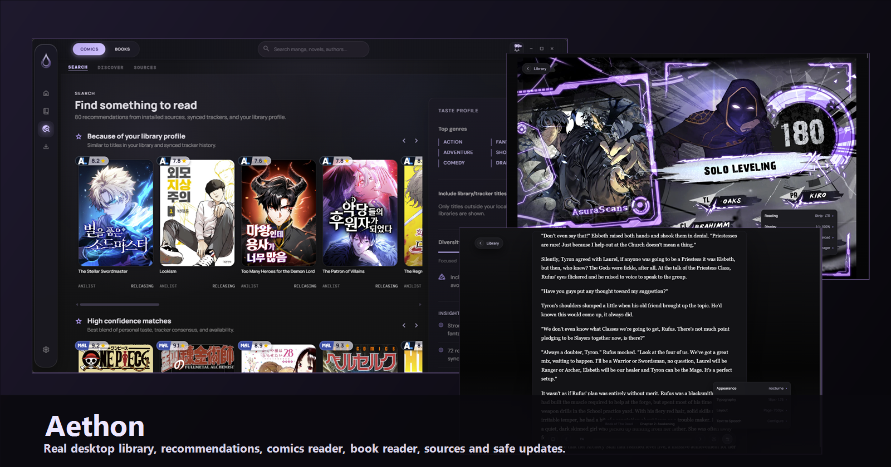
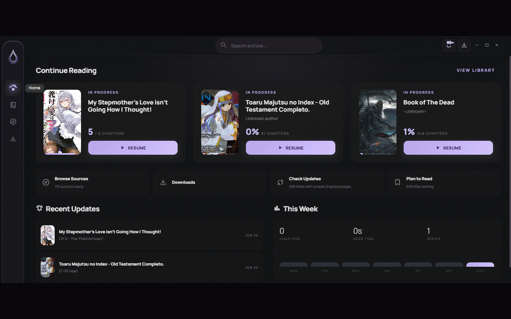
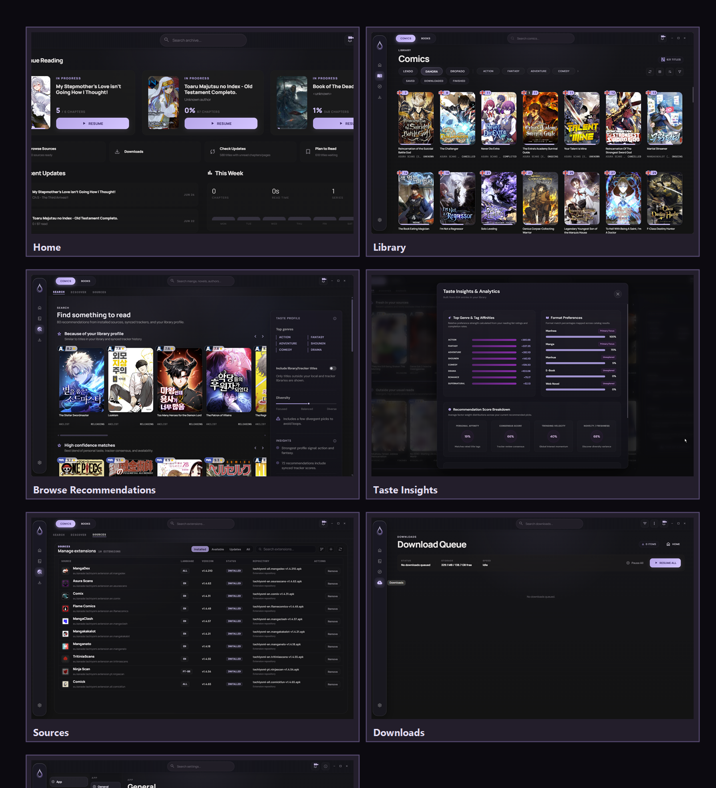

# Aethon

<p align="center">
  
</p>

<p align="center">
  <strong>A desktop reader, library manager, source manager, and safe Suwayomi runtime shell.</strong>
</p>

Aethon is a native desktop app for comics, manga, novels, and local books. It combines a Svelte 5 interface, Tauri v2 desktop integration, Suwayomi GraphQL for manga/comics, local book support, migration tools, downloads, TTS controls, backup/restore utilities, and a guarded runtime updater.

<p align="center">
  
</p>

## Preview

<p align="center">
  
</p>

<p align="center">
  
</p>

### Readers

<p align="center">
  
  
</p>

More real screenshots are available in [docs/screenshots](docs/screenshots).

## Current Features

### Core

- Unified desktop Library for comics/manga, LNReader-style source novels, EPUB books, and PDFs while keeping those domains separate internally.
- Home dashboard with continue reading, recent updates, this-week activity, recently finished titles, archive search, quick actions, source status, download status, reading metrics, and tracker status.
- Browse page with profile-based recommendations for manga and novels, source/tracker scoring, taste signals, recommendation categories, keyword search, Discover, source catalogs, and extension management.
- Suwayomi GraphQL integration for manga/comics metadata, chapters, sources, extensions, downloads, and library state.
- Local book support for imported EPUB/PDF/prose-style reading flows.
- Download queue management and downloaded manga fallback.

### Reader

- Manga reader with keyboard controls, fullscreen handling, progress tracking, bookmarks, scanlator ordering, and offline fallback.
- Novel reader for source-backed prose from LNReader-compatible extensions, with local state and chapter progress.
- EPUB reader for imported books.
- PDF reader with native page mode and reflow mode for prose-oriented reading.
- Book and novel presentation controls for local files and source-backed prose.
- Browser `speechSynthesis` TTS controls with persisted voice/rate/progress preferences.
- Stable placeholders and retry behavior for covers, thumbnails, and backdrops.

### Sources And Migration

- Installed/available manga extension management through Suwayomi.
- External `.apk` extension upload flow.
- Source search, discover, latest/catalog browsing, source filters, language-aware source handling, and repository management.
- LNReader-compatible novel repository and plugin flows are kept separate from Suwayomi manga extensions.
- Single-title manga migration.
- Source-based manga mass migration with review, matching, manual search, selection, retry/exclude actions, and journal-backed execution.
- Novel migration flow kept separate from manga migration.

### Safety And Reliability

- Suwayomi readiness checks that avoid destructive empty states while the backend is starting or reconnecting.
- Normalized empty GraphQL errors for clearer backend failure messages.
- Secure assisted Suwayomi runtime updater with ownership checks, compatibility allowlist, snapshot, staging, checksum validation, atomic promotion, rollback, and GraphQL health checks.
- Global write lock during Suwayomi update operations.
- Backup, restore, reconciliation, and snapshot utilities for app/library state.
- Toast notifications for update state and important user-visible operations.

### UI And UX

- Nocturne desktop visual system with dense, desktop-first layouts.
- Settings surfaces for appearance, reader behavior, library behavior, content/security, storage, tracking, backups, repositories, updater, and developer diagnostics.
- Theme editor and live theme preview.
- Paraglide localization with English, Portuguese, Spanish, Japanese, and Chinese catalogs.
- Keyboard-oriented controls and accessible modal/toast patterns in the main surfaces.

## Aethon-Specific Work

- Managed bundled Suwayomi runtime with local profile ownership checks.
- Safe Suwayomi runtime updater built for Aethon's desktop distribution model.
- Home is treated as an operational desktop hub, not a static landing page: it summarizes reading continuity, update pressure, downloads, source health, archive activity, and tracking state.
- Browse combines installed manga sources, LNReader novel sources, trackers, Hardcover data, and the user's Library profile to rank recommendations instead of only showing raw source catalogs.
- Recommendations expose why they were selected through provider signals, score breakdowns, profile tags, tracker/Hardcover signals, and source availability.
- Book reading is first-class: source novels, EPUB imports, PDF native mode, and PDF reflow mode live alongside manga/comics without sharing unsafe data paths.
- Single and mass migration flows designed around Aethon's Library and journal safety rules.
- Library split between comics/manga, source novels, and imported books without collapsing user data domains.
- Restore/reconciliation tooling for imported state, manga backups, novels, books, categories, and progress.
- Syncd groundwork for future device/session synchronization.
- Nocturne visual identity, Settings architecture, source management UI, and desktop runtime policy.

## Planned

These items are planned work, not completed functionality:

- Aethon Syncd productization and cross-device synchronization.
- PC-hosted Core services and contracts consumed by the separate Flutter/Sorayomi Aethon Mobile project.
- Design System consolidation.
- Reader improvements.
- TTS improvements.
- Performance improvements and startup profiling.
- Plugin workflow expansion.
- Updater UX and release automation improvements.
- Expanded source/extension support and diagnostics.

See [docs/roadmap.md](docs/roadmap.md) for the current roadmap.

## Install

Release packaging is Windows-first. Download releases from the official Aethon repository when published:

[https://github.com/johnnylord1/Aethon/releases](https://github.com/johnnylord1/Aethon/releases)

Aethon can run with its managed bundled Suwayomi runtime or connect to an external Suwayomi server from Settings.

## Development

Prerequisites:

- Node.js and pnpm.
- Rust via rustup.
- Tauri v2 prerequisites for your platform.
- Microsoft Edge WebView2 on Windows.

Install dependencies:

```bash
pnpm install
```

Run the web dev server:

```bash
pnpm dev
```

Run the desktop app:

```bash
pnpm tauri:dev
```

Run the managed desktop gate:

```bash
pnpm tauri:dev:gate
```

## Build

Build the frontend:

```bash
pnpm build
```

Build the Tauri app:

```bash
pnpm tauri -- build --config src-tauri/tauri.conf.json
```

Build the automation target:

```bash
pnpm tauri -- build --no-bundle --config src-tauri/tauri.automation.conf.json
```

## Tests

Run all Vitest projects:

```bash
pnpm test
```

Run focused unit/jsdom tests:

```bash
pnpm test:unit -- <files>
```

Run browser component tests:

```bash
pnpm test:browser
```

Run Rust updater tests:

```bash
cargo test --manifest-path src-tauri/Cargo.toml suwayomi_update
```

Check whitespace before finalizing changes:

```bash
git diff --check
```

## Architecture

- `src/components/pages` contains Home, Library, Browse, Downloads, Settings, detail, migration, source, and tracking screens.
- `src/components/library` contains shared Library shell/card/tooling UI.
- `src/components/reader` contains manga, novel, book, HUD, and TTS reader UI.
- `src/components/settings` contains settings panels, theme editing, repository panels, sync panels, and the Suwayomi updater panel.
- `src/lib/client.ts` contains the Suwayomi GraphQL client.
- `src/lib/manga` contains manga/source helpers.
- `src/lib/migration` contains single and mass migration logic plus journal handling.
- `src/lib/books` and `src/lib/novels` keep local books and novels separate from manga/comics.
- `src-tauri/src` contains native Tauri commands, managed runtime lifecycle, syncd, backup/restore, and updater backend logic.
- `messages` contains localized Paraglide messages.

## Credits

Aethon is an independent app with its own identity, release infrastructure, UI direction, and runtime policy. It began as a fork of Moku; that origin is credited here only for legal attribution and license continuity.

Aethon integrates with Suwayomi-Server:

[https://github.com/Suwayomi/Suwayomi-Server](https://github.com/Suwayomi/Suwayomi-Server)

## License

This repository preserves the Apache License 2.0 terms in [LICENSE](LICENSE).

## Disclaimer

Aethon does not host, provide, or distribute third-party content. Users are responsible for their own sources, servers, downloads, and local files.
