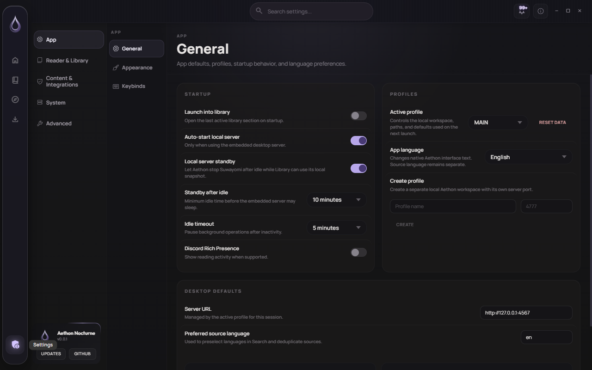

# Aethon

Aethon is a desktop reader and library manager for comics, manga, novels, and local books. It is built as a native Tauri application with a Svelte interface and integrates with Suwayomi-Server for manga and comic sources.

The project focuses on a quiet desktop workflow: fast library browsing, stable reading progress, source management, downloads, migration tools, and a bundled Suwayomi runtime for users who do not want to manage a separate server.

## Screenshots

<p align="center">
  
  
  
  
</p>

More screenshots are available in [docs/screenshots](docs/screenshots).

## Features

- Comics and manga library backed by Suwayomi GraphQL.
- Installed and available source extension management.
- Single title migration and source-based mass migration.
- Secure assisted Suwayomi runtime updater with ownership checks, compatibility allowlist, snapshot, staging, rollback, and health checks.
- Chapter downloads and local downloaded manga fallback.
- Reader with keyboard controls, fullscreen support, layout modes, progress tracking, bookmarks, and TTS controls.
- Local books and prose reading flows for EPUB/PDF/imported books.
- Desktop settings for sources, storage, reader behavior, security, backup, and app appearance.
- Paraglide-based localization.

## Tech Stack

- Tauri v2 desktop shell.
- Svelte 5, TypeScript, and Vite frontend.
- Rust backend commands under `src-tauri`.
- Suwayomi-Server GraphQL for manga/comics.
- Vitest projects for unit, jsdom shell, and browser component coverage.
- Paraglide for i18n messages.

## Installation

Release packaging is Windows-first at the moment. Download the latest installer from the official Aethon repository releases once published:

[https://github.com/johnnylord1/Aethon/releases](https://github.com/johnnylord1/Aethon/releases)

The app can run with its managed bundled Suwayomi runtime or point to an external Suwayomi server from Settings.

## Development

Prerequisites:

- Node.js and pnpm.
- Rust via rustup.
- Tauri v2 prerequisites for your platform.
- Microsoft Edge WebView2 on Windows.

Install dependencies:

```bash
pnpm install
```

Run the web dev server:

```bash
pnpm dev
```

Run the desktop app:

```bash
pnpm tauri:dev
```

Run the managed desktop gate:

```bash
pnpm tauri:dev:gate
```

## Build

Build the frontend:

```bash
pnpm build
```

Build the Tauri app:

```bash
pnpm tauri -- build --config src-tauri/tauri.conf.json
```

Build the automation target:

```bash
pnpm tauri -- build --no-bundle --config src-tauri/tauri.automation.conf.json
```

## Tests

Run all Vitest projects:

```bash
pnpm test
```

Run focused unit/jsdom tests:

```bash
pnpm test:unit -- <files>
```

Run browser component tests:

```bash
pnpm test:browser
```

Run Rust updater tests:

```bash
cargo test --manifest-path src-tauri/Cargo.toml suwayomi_update
```

Check whitespace before finalizing changes:

```bash
git diff --check
```

## Architecture

- `src/components/pages` contains primary app views such as Home, Library, Browse, Downloads, Settings, and detail screens.
- `src/components/reader` contains reader UI.
- `src/components/settings` contains settings panels and the Suwayomi updater panel.
- `src/lib/client.ts` contains the Suwayomi GraphQL client.
- `src/lib/manga` contains manga/source helpers.
- `src/lib/migration` contains migration and journal logic.
- `src/lib/books` and `src/lib/novels` keep local book and novel logic separate from manga.
- `src-tauri/src` contains native Tauri commands, managed runtime lifecycle, syncd, and updater backend logic.
- `messages` contains localized Paraglide messages.

## Roadmap

- Harden the release packaging flow.
- Continue improving Suwayomi readiness and source failure handling.
- Expand safe migration review tools.
- Improve release smoke coverage for Windows desktop builds.
- Keep Library, Reader, downloads, and updater behavior stable before broad feature expansion.

## Contributing

Keep changes small and focused. Preserve existing behavior unless the issue requires a behavior change. Run the focused checks for the touched area and include manual smoke notes for UI or desktop runtime work.

## Credits

Aethon is an independent project built on open-source reader ideas and the Suwayomi ecosystem. It began as a fork of Moku; that origin is credited here for licensing and attribution purposes only. Aethon branding, release identity, repository metadata, and product direction are independent.

Suwayomi-Server is developed by the Suwayomi project:

[https://github.com/Suwayomi/Suwayomi-Server](https://github.com/Suwayomi/Suwayomi-Server)

## License

This repository preserves the Apache License 2.0 terms in [LICENSE](LICENSE).

## Disclaimer

Aethon does not host, provide, or distribute third-party content. Users are responsible for their own sources, servers, downloads, and local files.
