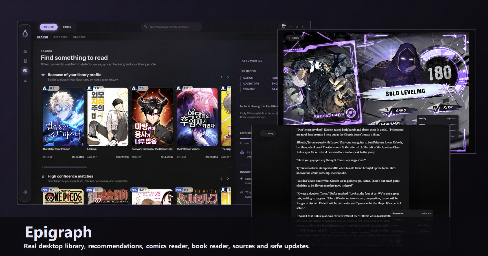
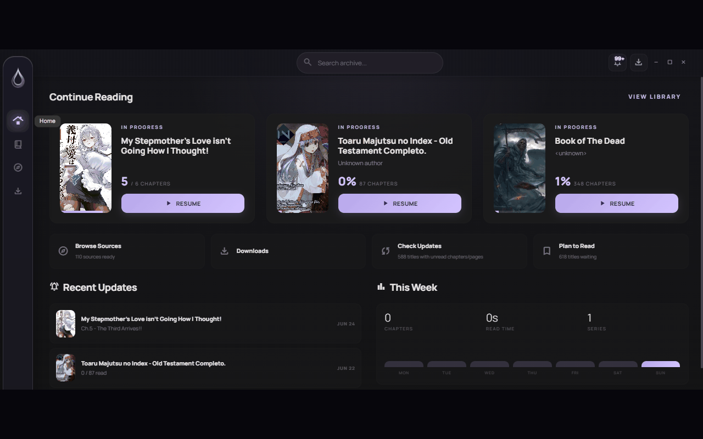
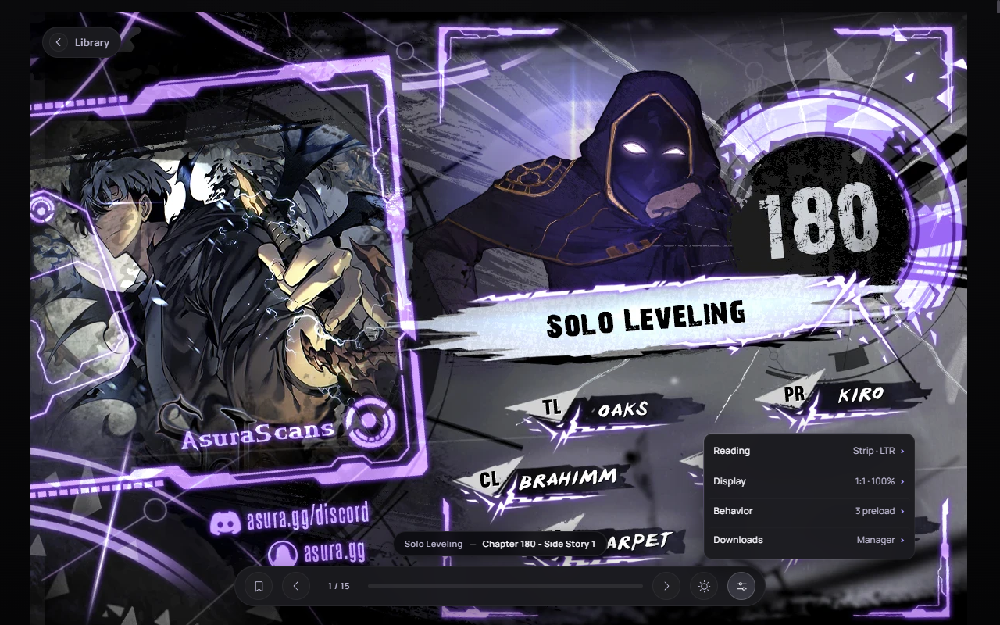
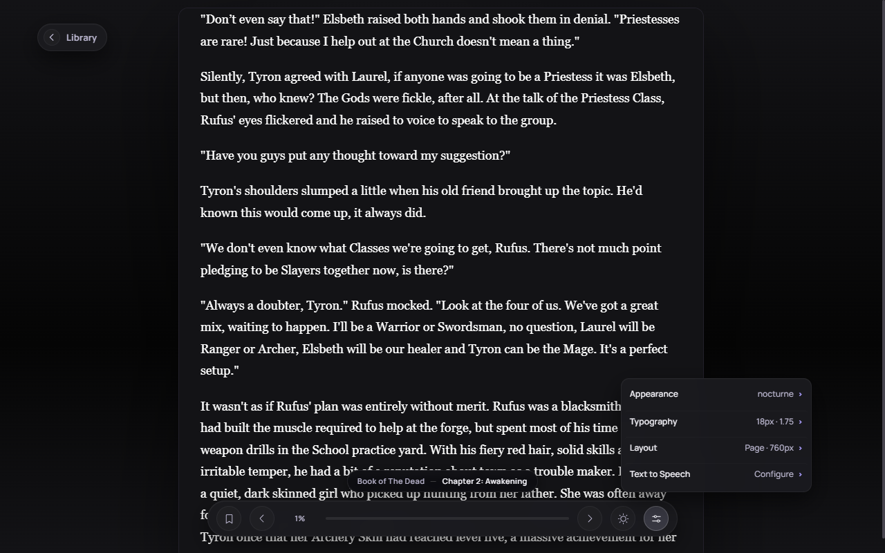

# Epigraph

  

  <strong>Your library, across desktop and Android.</strong> 
  Manga, novels, EPUB, and PDF reading with a shared Epigraph identity.

  <a href="https://github.com/johnnylord1/Epigraph/tree/main">Desktop</a> ·
  <a href="https://github.com/johnnylord1/Epigraph/tree/mobile">Android</a> ·
  <a href="https://github.com/johnnylord1/Epigraph/releases">Releases</a> ·
  <a href="https://github.com/johnnylord1/Epigraph/issues">Issues</a>

Epigraph is a cross-platform reading environment. The Windows-first desktop
client combines library management, source discovery, migration, downloads,
local books, and a guarded Suwayomi runtime. The native Android client brings
the mobile reading and library experience together with the same product
identity and compatibility model.

## Product overview

| Client | What it is | Identity | Branch |
| --- | --- | --- | --- |
| Desktop | Tauri v2 application for Windows and other desktop targets | <code>dev.epigraph.app</code> · <code>epigraph</code> | [main](https://github.com/johnnylord1/Epigraph/tree/main) |
| Android | Native Android reading and library client | <code>app.epigraph.mobile</code> | [mobile](https://github.com/johnnylord1/Epigraph/tree/mobile) |
| Shared services | Epigraph Core, Syncd, pairing, backup, and compatibility contracts | <code>epigraph://</code> · <code>.epigraphbk</code> | Shared by contract |

## Desktop

  

The desktop client is the operational hub for the full library:

- Unified library surfaces for manga and comics, source novels, EPUB books,
  and PDFs while keeping their data domains separate.
- Home and Browse dashboards for reading continuity, updates, downloads,
  recommendations, source health, trackers, and taste signals.
- Suwayomi GraphQL integration for manga metadata, chapters, sources,
  extensions, downloads, and library state.
- LNReader-compatible novel sources, local EPUB/PDF imports, TTS controls,
  offline reading, and reader-specific progress.
- Single-title and mass migration flows with review, matching, retry,
  exclusion, and journal-backed safety.
- Managed Suwayomi runtime updates with ownership checks, snapshots,
  checksums, rollback, and health gates.

The desktop-only and desktop-hosted capabilities are documented in the
[complete desktop feature catalog](docs/desktop-features.md). The highlights
are:

- A unified Browse/Search workspace with local-first search, installed-source
  search, Discover feeds, source filters, and keyboard-accessible results.
- A recommendation engine that combines library taste signals, ratings,
  tracker consensus, source availability, recency, momentum, and diversity,
  with explainable Taste Insights.
- Epigraph Core/Syncd as the persistent PC host for authenticated pairing,
  QR/manual bootstrap, LAN discovery, scoped replication, replay, snapshots,
  pause/resume, reconnect, and secure reader assets.
- A managed Suwayomi lifecycle with ownership checks, extension stores,
  transactional extension updates, health gates, snapshots, and rollback.
- Native desktop workflows for local EPUB/PDF books, offline comic reading,
  individual and mass migration, unified backup/restore, trackers, Discord
  Rich Presence, themes, and desktop window/keybind controls.

  

  
  

More desktop screens are available in
[docs/screenshots](https://github.com/johnnylord1/Epigraph/tree/main/docs/screenshots).

## Android

  
  

The Android client lives in the
[mobile branch](https://github.com/johnnylord1/Epigraph/tree/mobile) and is
built from the Hayai-based native foundation:

- Manga and comic library, source browsing, downloads, categories, trackers,
  backups, and offline reading.
- Native novel reader with LNReader-compatible JavaScript plugins and
  on-device QuickJS execution.
- Continuous chapter reading, TTS, reader controls, orientation preferences,
  progress positioning, and tablet-friendly layouts.
- Recommendation flows that distinguish manga and novels and search installed
  sources when a recommendation is selected.
- Stable, beta, and nightly build variants with crash reporting and migration
  tooling.

The Android application ID is <code>app.epigraph.mobile</code>. It is a new
installation alongside the previous package; Android does not allow the new
app to read the previous app's private sandbox automatically.
Use a backup/import flow or explicitly selected shared storage when moving
data.

## Cross-device compatibility

Epigraph keeps the persisted database and protocol identifiers stable where
compatibility requires it, while presenting the new product identity at the
edges:

- New deep links use <code>epigraph://</code>; supported legacy aliases
  remain accepted during the transition.
- New backups use <code>.epigraphbk</code>; supported legacy formats remain
  importable.
- New desktop and mobile headers use <code>X-Epigraph-*</code>; compatible
  legacy headers are still understood.
- New discovery publishes <code>_epigraph-sync._tcp.local.</code> and can
  discover the legacy service during transition.
- Desktop migration recognizes legacy storage roots and the new
  <code>Epigraph/epigraph</code> locations without silently overwriting newer
  data.
- Pairing can be established between new clients and supported legacy clients
  while the migration is in progress.

The Android sandbox boundary is intentional: installing Epigraph Mobile does
not remove or modify the legacy app, and a user-controlled backup/import is
required for private application data.

## Install

### Desktop

Desktop release artifacts are published on the
[Epigraph Releases page](https://github.com/johnnylord1/Epigraph/releases)
when available. The application can use its managed Suwayomi runtime or an
external Suwayomi server configured in Settings.

### Android

Android artifacts and build status are available from the
[mobile branch](https://github.com/johnnylord1/Epigraph/tree/mobile) and
[GitHub Actions](https://github.com/johnnylord1/Epigraph/actions). The
minimum supported Android version is Android 7.0.

## Build from source

### Desktop

Prerequisites: Node.js, pnpm, Rust via rustup, Tauri v2 prerequisites, and
Microsoft Edge WebView2 on Windows.

~~~bash
pnpm install
pnpm dev
pnpm tauri:dev
~~~

Build the frontend and Tauri application:

~~~bash
pnpm build
pnpm tauri -- build --config src-tauri/tauri.conf.json
~~~

### Android

Open the repository in Android Studio or run Gradle from the
<code>mobile</code> branch. The usual verification targets are:

~~~bash
./gradlew assembleDevDebug
./gradlew assembleStandardRelease
./gradlew test
./gradlew lint
~~~

## Tests

Desktop checks:

~~~bash
pnpm test:unit
pnpm test:browser
cargo test --manifest-path src-tauri/Cargo.toml
~~~

Android checks:

~~~bash
./gradlew test
./gradlew lint
~~~

Before committing, check for whitespace errors with
<code>git diff --check</code>. Release gates additionally validate bundle
metadata, updater configuration, package IDs, migrations, and compatibility
fixtures.

## Repository layout

- <code>main</code> contains the Epigraph desktop Tauri application,
  Epigraph Core/Syncd, UI, runtime policy, and desktop assets.
- <code>mobile</code> contains the native Android Epigraph client.
- <code>docs</code> contains architecture notes, roadmap material, and
  desktop screenshots.
- <code>src-tauri</code> contains native commands, storage compatibility,
  managed runtime lifecycle, pairing, backups, and updater logic.

See [docs/roadmap.md](https://github.com/johnnylord1/Epigraph/blob/main/docs/roadmap.md)
for planned work. The desktop client remains the PC-hosted Core boundary;
Android uses the authenticated contracts exposed by that boundary.

## Credits and legal

Epigraph is an independent product identity with its own release
infrastructure, UI direction, and runtime policy. Its desktop lineage
preserves the required upstream license continuity and attribution.

The Android foundation preserves the historical contributions and credits of
Hayai, Yōkai, Mihon, TachiyomiJ2K, TachiyomiSY, and LNReader. Their names and
licenses are provenance and attribution, not Epigraph branding.

Epigraph integrates with
[Suwayomi-Server](https://github.com/Suwayomi/Suwayomi-Server) and does not
host, provide, or distribute third-party content. Users are responsible for
their own sources, servers, downloads, and local files.

This repository preserves the terms of the
[Apache License 2.0](https://github.com/johnnylord1/Epigraph/blob/main/LICENSE).
