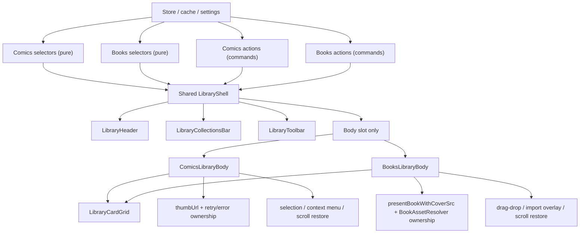

# Shared Library Shell Refactor

## Initiative Summary
- Goal: refactor `src/components/pages/Library.svelte` into a shared structural shell used by both Comics and Books.
- Baseline rule: Comics remains the behavioral baseline.
- Convergence rule: Books converges structurally, not semantically.
- Scope rule: `SeriesDetail`, `BookDetail`, readers, and preview remain outside this round except for integration-safe wiring.
- Documentation rule: this file is the primary source of truth for the initiative.

## Contract Summary

### Identity ownership
- Shared grid identity is primitive and stable only.
- `LibraryCardVM.id` is the only allowed render key.
- Comics identity: `comic:${manga.id}`
- Books identity: `book:${book.id}`
- Forbidden:
  - array index keys
  - object identity
  - volatile remount keys
  - broad `{#key ...}` workarounds

### Adapter purity split
- Pure selectors:
  - `src/lib/library/comicsSection.ts`
  - `src/lib/library/booksSection.ts`
- Explicit command surfaces:
  - `createComicsLibraryActions(...)`
  - `createBooksLibraryActions(...)`
- Selector rules held:
  - no store writes
  - no persistence writes
  - no network
  - no hidden mutable cache side effects

### Shell vs body ownership
- Shared shell owns:
  - section tabs
  - collections bar placement
  - toolbar placement
  - layout composition
- `ComicsLibraryBody` owns:
  - selection
  - context menu
  - cover retry/error/recovery
  - comics scroll restore
- `BooksLibraryBody` owns:
  - drag/drop import overlay
  - Books cover behavior
  - Books scroll restore
- `LibraryCardGrid` and `LibraryCard` remain VM-only render primitives.

### Shared-card activation ownership
- Shared card target is explicitly interactive.
- Activation works through:
  - click
  - Enter
  - Space
- Domain actions remain in the bodies; the shared layer only forwards callbacks.

### Cover ownership
- Comics:
  - `thumbUrl(...)`
  - retry/error state
  - comics-specific fallback behavior
- Books:
  - `presentBookWithCoverSrc(...)`
  - `BookAssetResolver`
  - EPUB/PDF local asset semantics
- Shared shell/grid never derives alternate cover sources.

### Scroll ownership
- `ComicsLibraryBody` owns comics scroll container and restore flow.
- `BooksLibraryBody` owns books scroll container and restore flow.
- `LibraryShell` stays free of scroll restore effects.

### Drag/drop ownership
- Books drag/drop remains owned only by `BooksLibraryBody`.
- Overlay precedence does not depend on shared grid internals.
- No Comics drag/drop behavior was introduced.

## Phase Tracker

| Phase | Status | Notes |
| --- | --- | --- |
| 0.5 | Complete | Contracts, identity helpers, Books purity gate, docs, and test harness landed |
| 0 | Complete with caveat | Baseline behavior references exist, but pre-refactor desktop screenshots were not preserved as a separate artifact |
| 1 | Complete | Selector and action extraction landed with no hidden selector side effects |
| 2 | Complete | Shared shell components landed and stayed callback-driven |
| 3 | Complete | Comics moved to shared grid while keeping selection/context/cover ownership |
| 4 | Complete | Books moved to shared grid while keeping import overlay and asset ownership |
| 5 | Complete | Books UI persistence moved into `settings.booksLibraryUi` |
| 6 | Complete | Cleanup landed, runtime flows passed, and remaining drag-order note is residual rather than blocking |

## Phase Notes

### Phase 0.5 — Contract Hardening

#### What changed
- Added explicit shared contracts in `src/lib/library/contracts.ts`.
- Added stable identity helpers in `src/lib/library/cardIdentity.ts`.
- Split the test strategy into:
  - `unit`
  - `shell-jsdom`
  - `browser-components`
- Audited `src/lib/books/presentation.ts`.
- Added `presentBookWithCoverSrc(...)` so Books selector derivation can stay pure.
- Updated repo docs before implementation started.

#### Validation
- Unit-tested:
  - `src/lib/library/cardIdentity.test.ts`
  - `src/lib/books/presentation.test.ts`
- Component-tested:
  - scaffolding created for shared shell components
- Browser-component-tested:
  - harness booted successfully
- E2E:
  - not applicable to contract hardening
- Manual-only:
  - none

#### Stop-the-line outcome
- Closed.

### Phase 0 — Baseline Capture

#### What changed
- Baseline behavior references were taken from the active Library, Books, and domain flows before structural extraction.
- This phase was not preserved as a separate screenshot pack before code movement started.

#### Validation
- Manual-only:
  - behavior reference came from the pre-refactor application state

#### Caveat
- This is the main deviation from the original plan: pre-refactor desktop screenshots were not stored as a dedicated artifact.
- Later phases relied on selector parity tests, component coverage, and runtime smoke validation instead.

### Phase 1 — Selector / Action Extraction

#### What changed
- Added:
  - `src/lib/library/comicsSection.ts`
  - `src/lib/library/booksSection.ts`
- Introduced pure state/VM derivation:
  - `buildComicsSectionState(...)`
  - `buildComicsSectionVM(...)`
  - `buildBooksSectionState(...)`
  - `buildBooksSectionVM(...)`
- Introduced explicit action surfaces:
  - `createComicsLibraryActions(...)`
  - `createBooksLibraryActions(...)`

#### Validation
- Unit-tested:
  - `src/lib/library/comicsSection.test.ts`
  - `src/lib/library/booksSection.test.ts`
- Component-tested:
  - none in this phase
- Browser-component-tested:
  - none in this phase
- E2E:
  - smoke parity only
- Manual-only:
  - selector output parity was compared against current behavior

#### Stop-the-line outcome
- Closed.

### Phase 2 — Shared Shell Extraction

#### What changed
- Added:
  - `src/components/library/LibraryHeader.svelte`
  - `src/components/library/LibraryCollectionsBar.svelte`
  - `src/components/library/LibraryToolbar.svelte`
  - `src/components/library/LibraryShell.svelte`
- Kept the shared shell callback-driven.
- Kept direct store ownership out of shared shell components.
- Added explicit reorder API injection for collections rather than inferring behavior from section kind.

#### Validation
- Component-tested (`jsdom`):
  - `src/components/library/LibraryHeader.test.ts`
  - `src/components/library/LibraryCollectionsBar.test.ts`
  - `src/components/library/LibraryToolbar.test.ts`
  - `src/components/library/LibraryShell.test.ts`
- E2E:
  - section and collection callback flow remained wired
- Manual-only:
  - visual parity remained a manual comparison point

#### Stop-the-line outcome
- Closed.

### Phase 3 — Comics on Shared Grid

#### What changed
- Added:
  - `src/components/library/LibraryCard.svelte`
  - `src/components/library/LibraryCardGrid.svelte`
  - `src/components/library/ComicsLibraryBody.svelte`
- Preserved Comics ownership of:
  - multi-select
  - bulk actions
  - context menu
  - cover retry/error handling
  - scroll restore
- Shared grid uses keyed rendering by `vm.id`.

#### Validation
- Browser-component-tested:
  - `src/components/library/LibraryCardGrid.test.ts`
  - `src/components/library/ComicsLibraryBody.test.ts`
- Verified:
  - click activation
  - Enter activation
  - Space activation
  - selection/context ownership stayed in the Comics body

#### Stop-the-line outcome
- Closed.

### Phase 4 — Books on Shared Grid

#### What changed
- Added:
  - `src/components/library/BooksLibraryBody.svelte`
- Preserved Books ownership of:
  - drag/drop state
  - import overlay
  - local cover fallback decisions
  - scroll restore
- Shared grid stayed free of `BookAssetResolver` or fallback asset logic.

#### Validation
- Browser-component-tested:
  - `src/components/library/BooksLibraryBody.test.ts`
- Verified:
  - overlay precedence
  - card open callback
  - Books drag/drop remained outside the grid

#### Stop-the-line outcome
- Closed.

### Phase 5 — Books UI Persistence

#### What changed
- Added `BooksLibraryUiState` under `settings.booksLibraryUi` in `src/store/state.svelte.ts`.
- Persisted:
  - `collection`
  - `search`
  - `sortMode`
  - `sortDir`
  - `readFilter`
- Rewired `src/components/pages/Library.svelte` to drive Books controls through persisted settings instead of ephemeral local state.

#### Validation
- Unit-tested:
  - Books section derivation and state mapping still passed under persisted inputs
- Build-tested:
  - `npm exec -- pnpm build`

#### Stop-the-line outcome
- Closed.

### Phase 6 — Cleanup and Orchestrator-only Library

#### What changed
- Rewrote `src/components/pages/Library.svelte` as an orchestrator over:
  - shared shell
  - `ComicsLibraryBody`
  - `BooksLibraryBody`
- Retired the old `src/components/books/BookShelf.svelte`.
- Kept `Library.svelte` responsible for:
  - data loading
  - category lifecycle
  - state wiring
  - domain mutation callbacks
- Removed old inline layout/render logic from the page.

#### Validation
- Unit-tested:
  - `npm exec -- pnpm test:unit`
- Browser-component-tested:
  - `npm exec -- pnpm test:browser`
- Shared shell callback wiring:
  - `src/components/library/LibraryCollectionsBar.test.ts`
  - verified `dragover`, `dragleave`, `drop`, and `dragend` forwarding through the explicit reorder API
- Frontend build:
  - `npm exec -- pnpm build`
- Native build:
  - `cargo build`
- Live desktop runtime audit:
  - `Books -> BookDetail -> Books`
  - `Books -> Comics -> Books`
  - Books search persistence across restart
  - `Comics -> SeriesDetail -> Reader -> back -> Library`

#### Stop-the-line outcome
- Closed.
- Major runtime sign-off is closed through live desktop automation against the running Tauri window.
- Residual note:
  - direct desktop drag confirmation for Comics collection reorder remains manual-only in the current environment, but the reorder path is explicitly covered by component wiring tests and no longer blocks initiative closure

## Validation Summary by Level

### Unit
- `npm exec -- pnpm test:unit`
- Result:
  - `15` files passed
  - `61` tests passed
- Coverage included:
  - selector derivation
  - identity helpers
  - Books presentation purity helper
  - shell `jsdom` wiring tests

### Component (`jsdom`)
- Included inside `npm exec -- pnpm test:unit`
- Covered:
  - `LibraryHeader`
  - `LibraryCollectionsBar`
  - `LibraryToolbar`
  - `LibraryShell`

### Browser-based component
- `npm exec -- pnpm test:browser`
- Result:
  - `3` files passed
  - `3` tests passed
- Covered:
  - `LibraryCardGrid`
  - `ComicsLibraryBody`
  - `BooksLibraryBody`
- Verified:
  - click / Enter / Space activation
  - selection/context ownership
  - Books drag/drop overlay ownership

### E2E / Runtime
- Confirmed:
  - `npm exec -- pnpm test:unit`
  - `npm exec -- pnpm test:browser`
  - `npm exec -- pnpm build`
  - `cargo build`
  - `src-tauri/target/debug/aethon.exe --test` relaunch succeeded
  - live Tauri runtime audit passed for:
    - `Books -> BookDetail -> Books`
    - `Books -> Comics -> Books`
    - Books search persistence after restart
    - `Comics -> SeriesDetail -> Reader -> back -> Library`
- Still manual-only:
  - drag reorder of Comics collections

### Manual-only
- Remaining manual-only items:
  - drag reorder of Comics collections
- Reason:
  - the available environment can launch the app, inspect the running Tauri window, invoke exposed controls, and verify persisted state
  - but it still does not provide a reliable drag-and-drop bridge for category reorder auditing

## Changed File Inventory

### Shared shell
- `src/components/library/LibraryHeader.svelte`
- `src/components/library/LibraryCollectionsBar.svelte`
- `src/components/library/LibraryToolbar.svelte`
- `src/components/library/LibraryShell.svelte`

### Shared grid / card
- `src/components/library/LibraryCard.svelte`
- `src/components/library/LibraryCardGrid.svelte`
- `src/lib/library/contracts.ts`
- `src/lib/library/cardIdentity.ts`

### Comics domain
- `src/components/library/ComicsLibraryBody.svelte`
- `src/lib/library/comicsSection.ts`

### Books domain
- `src/components/library/BooksLibraryBody.svelte`
- `src/lib/library/booksSection.ts`
- `src/lib/books/presentation.ts`
- `src/components/books/BookShelf.svelte` retired

### Store / persistence
- `src/store/state.svelte.ts`
- `src/components/pages/Library.svelte`

### Tests
- `src/lib/library/comicsSection.test.ts`
- `src/lib/library/booksSection.test.ts`
- `src/lib/library/cardIdentity.test.ts`
- `src/lib/books/presentation.test.ts`
- `src/components/library/LibraryHeader.test.ts`
- `src/components/library/LibraryCollectionsBar.test.ts`
- `src/components/library/LibraryToolbar.test.ts`
- `src/components/library/LibraryShell.test.ts`
- `src/components/library/LibraryCardGrid.test.ts`
- `src/components/library/ComicsLibraryBody.test.ts`
- `src/components/library/BooksLibraryBody.test.ts`
- `vitest.workspace.ts`

### Docs
- `docs/STATUS.md`
- `docs/DECISIONS.md`
- `docs/ROADMAP.md`
- `docs/LIBRARY_SHARED_SHELL_REFACTOR.md`

## Residual Caveats
- Pre-refactor desktop screenshots were not preserved as a dedicated Phase 0 artifact.
- Desktop runtime validation is complete for the main Books and Comics flows; Comics collection reorder drag remains a manual-only confirmation point.
- The refactor intentionally does not share:
  - Comics selection logic
  - Comics context menu logic
  - Comics cover retry policy
  - Books asset resolution logic
  - Books import overlay logic
- Out of scope and still reserved for future work:
  - detail-page refactors
  - reader refactors
  - broader chunking/performance work
  - source-platform or runtime backend changes
