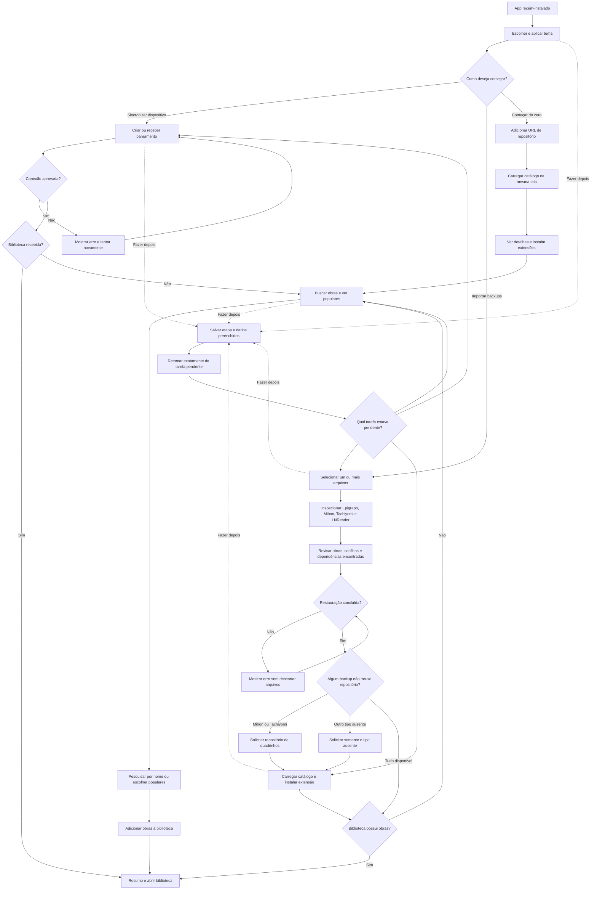

# Fluxo do primeiro uso do Epigraph

## Regra de dependências de backup

- Mihon/Tachiyomi: restauram biblioteca, categorias e progresso, mas exigem que o usuário informe novamente o repositório de quadrinhos.
- Epigraph ou outros formatos: o planner reutiliza somente dependências efetivamente presentes e válidas.
- Importação mista: preserva as dependências encontradas e pede apenas as ausentes.
- A configuração de repositórios acontece dentro do first run, sem enviar o usuário para Configurações.
