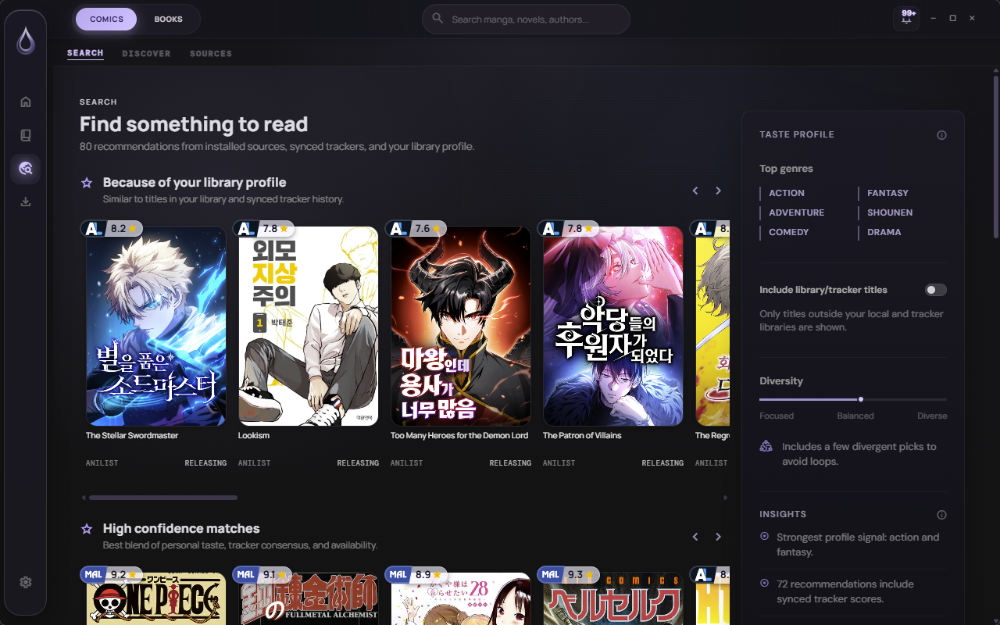
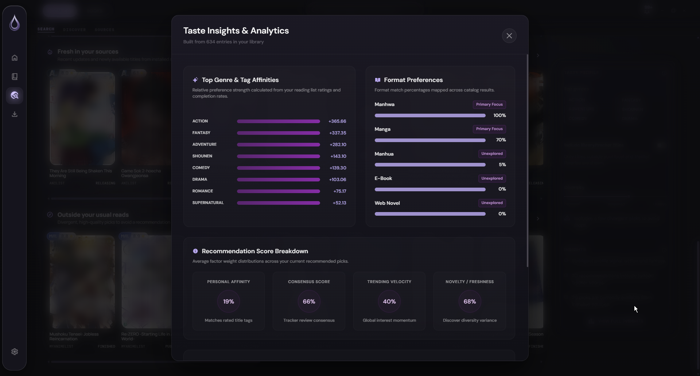

# Epigraph Desktop — Feature Catalog

This page is the public inventory of the capabilities that are specific to
the Epigraph desktop experience or hosted by the desktop Core. It describes
the implementation on the `main` branch, not a future roadmap. Basic manga,
novel, and reading capabilities can overlap with Android; the desktop adds the
full orchestration, discovery, local-content, and PC-host features below.

<p align="center">
  
  
</p>

## Capability map

| Desktop capability | What is included | Availability |
| --- | --- | --- |
| Browse and Search workspace | Search, Discover, Sources, local-first palette, installed-source search, filters, pagination, and keyboard navigation | Implemented; live results need configured sources or a server |
| Recommendation engine | Personal taste profile, tracker/source enrichment, explainable score factors, deduplication, safety filters, and diversity sections | Implemented; enrichment is best with library/tracker/source data |
| Epigraph Core and Syncd host | Persistent PC service, pairing, discovery, scoped replication, replay, snapshots, reconnect, and authenticated assets | Implemented; the PC must be online for live remote operations |
| Managed Suwayomi runtime | Startup/reattach, ownership validation, readiness, updater, extension stores, health gates, and rollback | Implemented; compatible runtime artifacts are required |
| Unified multi-domain library | Comics, source novels, local EPUB books, and local PDFs with independent state boundaries | Implemented |
| Desktop migration and data safety | Single/mass migration, chapter mapping, journals, undo/compensation, offline assets, backup audit, and restore planning | Implemented; source-to-source migration needs compatible sources |
| Native desktop operations | Window lifecycle, autostart, fullscreen, keybinds, zoom, system paths, logs, updater, themes, and Discord presence | Implemented; external integrations are optional |

## Browse and Search

The desktop Browse surface is a three-part discovery workspace for comics and
novels:

- **Search** queries the visible installed sources for the active content type.
  Each source reports its own loading, result, empty, and error state, with
  source-aware detail navigation and progressive result loading.
- **Discover** supports all, popular, and latest catalog feeds, genre/tag
  selection, `AND`/`OR` tag matching, preferred language, source/tracker
  filters, pagination, and safe-content filtering. Genre aliases handle
  equivalent labels without changing the source contract.
- **Sources** exposes the installed source and extension inventory, source
  preferences, language visibility, NSFW visibility, repository setup, and
  the corresponding novel repository/plugin inventory.

The shared desktop Search Palette adds a second layer without replacing those
page-specific contracts:

- Home searches local comics, imported books, hydrated source novels,
  collections, settings, downloads, and navigation actions.
- Library searches only the active Comics or Books collection, including
  matching categories and source novels where applicable.
- Browse searches remote installed sources only after the explicit
  **Search in Browse** action. Discover and Sources keep their own filters.
- Settings and Downloads expose their current local actions and controls as
  searchable results.
- Queries are normalized for case, accents, punctuation, and spacing. Results
  use deterministic exact/prefix/partial/keyword/description/context ranking,
  typed actions, deduplication, bounded caching, cancellation of stale remote
  work, and route-safe focus restoration.
- Results keep the current library visual hierarchy: cover, title, source,
  status, and one horizontally scrollable row per result group. The palette
  exposes combobox/listbox semantics and keyboard navigation.

The desktop source boundary uses the typed Suwayomi runtime contract for
metadata, details, chapters, and chapter pages. The novel path uses trusted
installed JavaScript source plugins through the isolated novel runtime host.
Raw GraphQL is not exposed to the UI search palette.

Implementation: [BrowseV3.svelte](../src/components/pages/BrowseV3.svelte),
[SearchPalette.svelte](../src/components/search/SearchPalette.svelte),
[search pipeline](../src/lib/search/), and
[search audit](search-system-audit.md).

## Recommendation engine

Recommendations are calculated locally from the desktop's current catalog and
the provider data available to the active profile. The engine accepts:

- manga/comic library entries and source results;
- novel library/source results;
- local EPUB/PDF book metadata and reading progress;
- tracker records and tracker search results;
- native Hardcover records for book and novel tracking; and
- optional provider signals such as score, popularity, trend, recency, and
  source availability.

### How the score is built

1. Titles, tags, formats, providers, and metrics are normalized into one
   candidate model. Structural tags and language labels do not pollute taste
   signals.
2. The taste profile learns weighted tags, content formats, and source
   affinity from explicit ratings and implicit behavior. Completed, reading,
   planning, and dropped states have different weights; dropped works provide
   negative evidence when no explicit rating exists.
3. Every candidate receives an explainable breakdown:
   personal rating affinity, profile-tag overlap, content-type fit, source
   affinity, content similarity, tracker consensus, trending velocity,
   recency, source availability, and novelty.
4. The final score is clamped to a stable `0..1` range. Its current weighted
   blend is:

   ```text
   34% personal rating affinity
   16% content similarity
   18% tracker consensus
   10% trending velocity
    8% recency
    6% source availability
    4% source affinity
    4% novelty
   ```

5. Candidates are filtered by content family, safety settings, library
   inclusion, blocked tags, and provider evidence. Duplicate titles and
   provider identities are removed before display.
6. Diversity re-ranking prevents a result row from becoming a copy of one
   narrow preference. Items are classified as familiar, adjacent, or
   divergent and interleaved in a stable order.

The desktop presents five explainable recommendation sections:

- **Because of your library profile**
- **High confidence matches**
- **Trending near your taste**
- **Fresh in your sources**
- **Outside your usual reads**

Taste Insights exposes the active tag affinities, preferred formats, average
recommendation factor values, tracker/source evidence, and extension signals
that can unlock additional catalog candidates. The engine keeps empty sections
empty when external data is unavailable; it does not fabricate recommendations.

Implementation: [recommendation types](../src/lib/recommendations/types.ts),
[engine](../src/lib/recommendations/engine.ts),
[ranking](../src/lib/recommendations/ranking.ts),
[taste profile](../src/lib/recommendations/tasteProfile.ts), and
[TasteInsightsModal.svelte](../src/components/pages/TasteInsightsModal.svelte).

## Epigraph Core and Syncd

The desktop is the PC host for Epigraph Core and Syncd. Core is a persistent
current-user service: closing the desktop window detaches the UI but does not
terminate the service. The desktop can start, stop, inspect, and configure the
host through the native sidecar and Settings panel.

### Pairing and discovery

- QR/bootstrap pairing or manual bundle entry establishes a device session.
- LAN discovery publishes and consumes the Epigraph Sync service through mDNS,
  while a manual endpoint remains available as a fallback.
- The host validates the server identity, TLS certificate fingerprint,
  profile, access token, and requested scopes before accepting a device.
- Pairing approval, rejection, device listing, scope changes, disconnect,
  session revalidation, and forget operations are exposed in the desktop UI.
- Persisted sessions have explicit status, last discovery source, and active
  session selection instead of being silently reused.

### Replication and recovery

Syncd provides durable, profile-scoped replication with:

- an authenticated mutation route and idempotent mutation receipts;
- durable outbox processing with pause, resume, retry, and reconnect;
- ordered event streams and replayable change history;
- authoritative snapshots for recovery and cold-start hydration;
- tombstones and identity aliases for safe deletes and migrations;
- profile-scoped comic and novel state plus a separate global book scope; and
- authenticated cover, chapter, book, and plugin metadata asset routes where
  the contract permits them.

The supported state boundary is deliberately explicit:

| Domain | Replicated desktop-host state | Kept local or excluded |
| --- | --- | --- |
| Comics | Library metadata, categories, reader/progress state, bookmarks, and the profile catalog projection | Arbitrary upstream GraphQL and direct loopback access |
| Novels | Library entries, progress, bookmarks, history, repository metadata, installed-plugin metadata, source snapshots, and allowlisted settings metadata | Chapter content, plugin binaries, cookies, tokens, credentials, and arbitrary web storage |
| Books | Global library metadata, progress, bookmarks, and history where supported | Book file assets remain local to the device |

The mobile client consumes typed Core routes after pairing; it does not reach
the Suwayomi loopback port directly. The PC session and Core/Suwayomi processes
must be alive for live online catalog and chapter operations, while downloaded
and cached content remains usable offline.

### LAN and process safety

- Loopback is the default binding.
- Temporary LAN exposure is profile-scoped, owner-PID-scoped, and TTL-bound.
- Invalid, expired, mismatched, or stale exposure state collapses back to
  loopback and is cleaned up at shutdown.
- Installer and updater lifecycle commands stop only processes whose ownership
  manifests, PID, endpoint, and root directory match the desktop runtime.
- Foreign processes and foreign Suwayomi profiles are never terminated by the
  desktop supervisor.

Implementation: [Syncd connection panel](../src/components/settings/SyncdConnectionPanel.svelte),
[desktop Syncd bridge](../src/lib/syncdDesktop.ts),
[Syncd server](../src-tauri/src/syncd/),
[replication](../src-tauri/src/syncd_replication.rs),
[Core lifecycle](epigraph-core-windows-lifecycle.md), and
[novel Syncd contract](novel-runtime-syncd-integration.md).

## Managed Suwayomi runtime and extensions

The desktop can supervise a compatible managed or bundled Suwayomi runtime while
also supporting an external server configured by the user.

- Startup resolves the runtime relative to the desktop sidecar, prefers a
  windowless Java process on Windows, and waits for the expected loopback
  listener and GraphQL readiness.
- An owner manifest, exact `rootDir`, PID, Java executable, endpoint, and
  process command line form the ownership boundary for attach, stop, update,
  and uninstall.
- Existing managed profiles can be reattached after login. A foreign process,
  occupied port, or mismatched profile is reported rather than killed.
- Runtime updates stage the release, validate compatibility and checksums,
  snapshot the current profile, promote only after health checks, and restore
  the previous runtime automatically when promotion or health validation fails.
- Extension updates use configured stores and source inventories. Exact
  artifacts are staged in a candidate profile, checked for package/version and
  registered-source identity, health-checked, then promoted as a transaction.
  An update journal supports recovery after interruption.
- Optional FlareSolverr integration can be configured for source access that
  requires a local or Docker anti-bot service; it is not required for the
  desktop shell or local content.

Implementation: [runtime supervisor](../src-tauri/src/suwayomi_runtime.rs),
[runtime updater](../src-tauri/src/suwayomi_update.rs),
[source runtime](../src/lib/manga/runtime/),
[runtime lifecycle guide](epigraph-core-windows-lifecycle.md), and
[Suwayomi replan](suwayomi-runtime-replan.md).

## Unified desktop library

The desktop library keeps different content authorities separate while giving
the user one operational workspace:

- Comics and manga from Suwayomi sources, with source metadata, chapters,
  categories, downloads, progress, bookmarks, and tracker bindings.
- Source novels from trusted LNReader-compatible repositories and plugins,
  with profile-scoped library state, chapters, progress, history, offline
  chapters, and plugin/source metadata.
- Local EPUB and PDF files with import, metadata identity, cover handling,
  categories, progress, bookmarks, local assets, and restart-safe persistence.
- Search, genre/status filters, sort direction, density/layout controls,
  categories/folders, bulk selection, bulk actions, and virtualized grids.
- Background library hydration, cover caching, update state, download queue
  state, and activity history without mixing the state domains.

### Readers and offline behavior

- Comic reader modes include single-page, double-page, and long-strip layouts.
  The HUD provides page/chapter navigation, keyboard commands, zoom, fullscreen,
  progress, bookmarks, and reader preferences.
- Downloaded comic chapters have a native offline fallback that reads local CBZ
  assets, preserves source-page order, and keeps offline progress separate from
  display segmentation.
- The EPUB reader supports local chapter navigation, text reflow preferences,
  typography/palette controls, progress, bookmarks, and persisted reading
  position.
- The PDF reader supports local page navigation, zoom, page progress,
  bookmarks, and the desktop book asset boundary.
- Novel reading runs through an isolated hidden runtime host with an explicit
  capability allowlist for trusted source plugins. Chapter HTML is adapted to
  the common reader shell rather than granting plugins unrestricted desktop
  access.
- Text-to-speech controls are shared by the reader surfaces where the content
  adapter supports speech.
- Downloads expose queued, active, finished, failed, pause, resume, cancel,
  retry, and local/offline states.

Implementation: [library components](../src/components/library/),
[book modules](../src/lib/books/),
[novel modules](../src/lib/novels/),
[reader components](../src/components/reader/), and
[reader UX contract](reader-ux-contract.md).

## Migration, backup, and restore

The desktop owns the complete data-movement workflow:

- Individual manga and novel migration with source matching, chapter mapping,
  review, retry, exclusion, and target-detail preview.
- Mass migration with per-item readiness, low-confidence review, duplicate
  target protection, progress/bookmark/history transfer, and child-operation
  status.
- Journal-backed operations with checkpoints, verification after each write,
  compensation on failure, and undo where the operation remains reversible.
- Preservation and verified copying of offline comic/novel assets, local
  identity links, folder mappings, tracker bindings, and Hardcover bindings.
- Unified backup containers with checksums, format detection, audit-only mode,
  restore planning, sandboxed writes, corruption rejection, and explicit
  reconciliation of library identity/progress/category state.
- Separate manga, book, novel, application, and provider bridges so a partial
  restore cannot silently overwrite an unrelated state domain.

The import path accepts supported existing backup formats while new exports use
the current Epigraph format. Restore is staged and verified before a state is
committed.

Implementation: [migration modules](../src/lib/migration/),
[backup modules](../src/lib/backup/),
[migration dialogs](../src/components/pages/MigrateModal.svelte), and
[mass migration dialog](../src/components/pages/MassMigrateModal.svelte).

## Tracking and desktop integrations

- Suwayomi tracker providers are discovered dynamically and expose OAuth,
  search, status, score, progress, private/public state, and tracker-bound
  detail actions.
- Hardcover is a native scoped integration for book/novel records, ratings,
  status, search, cover enrichment, and recommendation signals. Rate-limit
  cooldowns and cached records keep background enrichment bounded.
- Discord Rich Presence can show navigation, active reading, title, cover,
  progress, and download activity, with privacy toggles and cover safety
  filtering.
- Settings are organized into General, Appearance, Reader, Library, Content,
  Categories, Tracking, Storage, Performance, Security, About, and developer
  diagnostics surfaces.
- The theme system includes built-in themes, Nocturne states, an editor,
  reduced-motion handling, tokenized component styling, and persistence across
  the desktop shell.
- Native Tauri controls provide a custom title bar, inline window controls,
  application fullscreen, reader zoom, configurable keybinds, autostart,
  process/log diagnostics, native file selection, and updater lifecycle.
- The Activity Center combines reading history, update/download activity, and
  actionable notifications in the Home shell.

## Boundaries users should know

The desktop shell and local library work without a remote catalog, but some
capabilities intentionally depend on external configuration:

- Browse live results need a reachable Suwayomi server with visible sources or
  an enabled trusted novel repository/plugin.
- Tracker and Hardcover features need the user's own credentials/tokens.
- Runtime and extension updates need a compatible release artifact and a
  reachable update source.
- Anti-bot handling needs a configured local/Docker FlareSolverr service when
  a source requires it.
- Online mobile pairing and live Core catalog operations need the PC session
  and its Core/Suwayomi processes. Cached/downloaded content remains available
  within the supported offline boundary.

These dependencies are represented as loading, empty, retry, and error states;
the UI does not replace missing external data with fabricated records.

## Implementation and verification map

| Area | Primary implementation | Evidence |
| --- | --- | --- |
| Browse/Search | `src/components/pages/BrowseV3.svelte`, `src/components/search/SearchPalette.svelte`, `src/lib/search/` | [Search system audit](search-system-audit.md) |
| Recommendations | `src/lib/recommendations/`, `src/components/pages/TasteInsightsModal.svelte` | Recommendation unit tests and Browse behavior tests |
| Core/Syncd | `src-tauri/src/syncd/`, `src-tauri/src/syncd_replication.rs`, `src/lib/syncdDesktop.ts` | [Functional audit](functional-audit.md), [Core lifecycle](epigraph-core-windows-lifecycle.md) |
| Suwayomi lifecycle | `src-tauri/src/suwayomi_runtime.rs`, `src-tauri/src/suwayomi_update.rs` | [Suwayomi certification baseline](suwayomi-certification-baseline-v2.3.2243.md) |
| Books and readers | `src/lib/books/`, `src/components/reader/` | [Reader UX contract](reader-ux-contract.md), functional audit |
| Migration and backup | `src/lib/migration/`, `src/lib/backup/`, migration dialogs | Functional audit and focused migration/backup tests |
| Native integrations | `src-tauri/src/`, settings panels, Discord modules | [Desktop lifecycle guide](epigraph-core-windows-lifecycle.md), functional audit |

The desktop release gates currently include:

```text
pnpm build
pnpm test:unit
pnpm test:browser
cargo test --manifest-path src-tauri/Cargo.toml
git diff --check
```

The detailed functional audit records which scenarios are fully local, which
were exercised with isolated Core/runtime profiles, and which require a live
external source or user credential.
