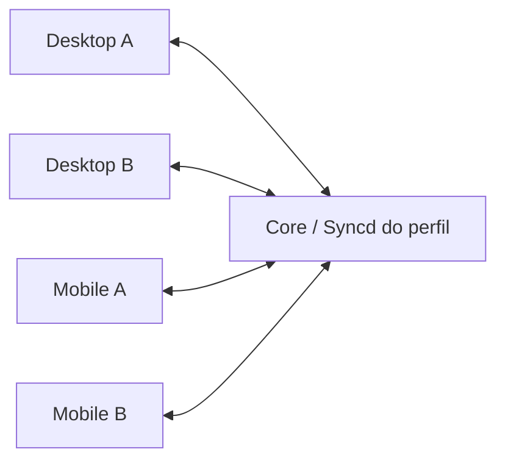

# Auditoria do Syncd — 10 de novembro de 2026

## Escopo e arquitetura

A auditoria inclui o estado de trabalho não commitado dos checkouts desktop e
mobile. O histórico do chat Claude não estava disponível na lista de chats;
os diffs, testes e documentos locais foram a fonte do trabalho anterior.
As alterações já presentes foram preservadas. Nenhuma biblioteca real foi
apagada, reimportada ou deduplicada por título.

O Core pareado é a autoridade comum: desktop ↔ desktop, desktop ↔ mobile e
mobile ↔ mobile convergem por ele. Dois celulares precisam alcançar o mesmo
Core/perfil; o Android não hospeda um Syncd e não há pareamento direto entre
celulares. A sincronização não oferece transporte pela internet por si só.
Comics e novels são separados por perfil; livros usam `books:global`.
IDs de banco Suwayomi/Android não são identidades globais de obras.



## Defeitos reproduzidos e correções

### Estado parcial de capítulos

Um `comic.chapter_state` com `read=null` significa “não alterar lido”. O banco
substituía o registro inteiro pelo patch: ler um capítulo e depois alterar
somente outra propriedade removia o `read` do snapshot e do replay. A projeção
pendente de Suwayomi tinha uma combinação própria, mascarando a divergência.

O Core agora combina `read`, `bookmarked`, `lastPageRead` e `lastReadAtMs` com o registro anterior
na mesma transação, antes de escrever estado, change log e projeção. Valores
explícitos `false` e `0` continuam sendo alterações. A regressão verifica tanto
o snapshot quanto o último envelope, além da projeção.

### Duplicação de novels no Android

Uma novel com plugin/path, mas sem idioma, recebia um source sintético na réplica.
A hidratação portátil podia criar outra favorita sob o source do plugin porque
não conhecia o placeholder. A ordem inversa também podia criar uma cópia extra.

`projectNovelEntry` passa a consultar e registrar o vínculo exato plugin/path,
reutilizando o source da cópia vinculada e reconciliando o placeholder anterior.
A resolução pendente continua pendente até a hidratação verificar a dependência.
Os testes cobrem réplica primeiro, vínculo primeiro e repetição do mesmo evento.
Obras com títulos iguais em fontes diferentes continuam distintas.

Identidades legadas passam a alcançar a cópia canônica sem apagar as identidades,
progresso e bindings antigos por cascata. Capítulos, favoritos, categorias,
histórico e remoção usam esse vínculo; um tombstone antigo não apaga progresso
canônico recebido depois. Locators portáteis conservam o ID portátil do capítulo,
mesmo quando a chave estrangeira local ainda usa um binding legado.

### Limpeza de metadados entre celulares

Apagar autor/descrição enviava `null` corretamente ao Core, mas a projeção Android
restaurava o valor anterior. Agora um campo omitido preserva compatibilidade e
um `null` explícito limpa o valor. Um teste verifica ambas as situações.

### Paginação de snapshots

Cada página antes carregava, desserializava e ordenava o escopo inteiro. O custo
de um bootstrap crescia aproximadamente com o quadrado do tamanho da biblioteca.
As consultas agora usam o cursor e `LIMIT` antes da desserialização. Cada tipo
carrega no máximo o tamanho da página mais um registro; tipos anteriores ao cursor
não carregam registros. Tombstones são consultados somente na página final.
A versão e os registros de cada página continuam sendo lidos na mesma transação.
O cliente ainda retoma o replay a partir da versão da primeira página.

### Trabalho desnecessário no desktop

Eventos de comics e eventos já consumidos não precisam abrir os arquivos de
livros, capítulos de novels ou classificação. O planejamento do lote agora
filtra escopos/checkpoints antes dessas leituras e só carrega os domínios usados.
Eventos conhecidos de catálogo e tipos futuros ignorados consomem a versão do
feed, evitando replay repetido na reconexão.
Escopos sem alterações também avançam até a versão global já consumida, com
validação da sessão e do Core dentro da gravação. Uma resposta atrasada da sessão
anterior não pode avançar os checkpoints da sessão nova.

### Texto Unicode no stream ao vivo

O cliente desktop convertia cada chunk HTTP isoladamente em texto. Um caractere
UTF-8 dividido entre chunks virava caracteres de substituição, corrompendo títulos
e outros textos. O decoder comum às conexões local e remota agora conserva bytes
até completar a linha SSE. Testes enviam português, japonês e emoji byte a byte.

### Gravações concorrentes da réplica desktop

A substituição atômica de JSON impedia arquivos parciais, mas não a perda de uma
alteração entre duas sequências concorrentes de leitura/modificação/gravação.
As gravações de estado agora compartilham uma seção crítica síncrona curta.
Após operações de rede, o replay aplica seu delta sobre o estado atual, preservando
pausa, confirmações da UI, alterações de outro perfil e edições locais em progresso.
Uma troca de Core/sessão invalida a aplicação antiga antes da gravação dos domínios.

### Recuperação com tipos adicionais de snapshot

Um snapshot de novels com `novel.tracking` ou `novel.chapter_asset`, que o Core
já pode publicar, antes encerrava a recuperação com “Unsupported novel snapshot
entity”. Tipos com consumidores separados e tipos futuros agora são ignorados
pelo materializador de biblioteca, como já acontece no replay incremental.
Os registros conhecidos continuam sendo validados e materializados.

## Evidências e limites

- Base inicial: 594 testes Rust de Syncd e 119 testes frontend focados passaram.
- A regressão do capítulo falhou antes da correção: snapshot retornava `read=null`.
- A regressão da paginação falhou antes da correção: uma página decodificava um registro distante.
- A regressão Android de metadados falhou antes da correção: autor antigo permaneceu.
- As duas regressões Android de vínculo portátil falharam antes da correção.
- Após a correção da paginação: 54 testes Rust de snapshot passaram.
- Após a proteção concorrente: 108 testes de replicação desktop passaram.
- A suíte Rust ampliada chegou a 603 testes aprovados; a rodada final abaixo
  também inclui a regressão de tipos adicionais no snapshot.

Comandos usados no desktop:

```powershell
pnpm test:unit
pnpm test:unit -- src/components/settings/Settings.test.ts src/components/firstRun/FirstRun.test.ts --maxWorkers=1 --minWorkers=1
pnpm build
cd src-tauri
cargo test --lib syncd -- --test-threads=2
```

No Android, foi usado o JBR 21 já instalado como fallback local documentado,
sem alterar a versão Java 17 do CI. O cache incremental Kotlin apresentou uma
falha LZ4; a validação foi repetida sem reutilizá-lo, sem apagar dados:

```powershell
.\gradlew.bat :app:testDevDebugUnitTest --tests 'epigraph.sync.core.*' :data:testAndroidHostTest :data:verifySqlDelightMigration --max-workers=2 --no-build-cache '-Pkotlin.incremental=false' '-Pkotlin.compiler.execution.strategy=in-process' --console=plain
```

Os testes usam bancos e servidores locais descartáveis. Falhas iniciais de
permissão de socket/temporários do sandbox foram distinguidas dos defeitos e
os testes foram repetidos com a permissão necessária. Outro trabalho também
executava testes Gradle no mesmo checkout; uma falha transitória de empacotamento
foi repetida com sucesso sem encerrar processos alheios.

Resultado final:

| Verificação | Resultado |
|---|---|
| `cargo test --lib syncd -- --test-threads=2` | 603 passaram, 0 falhas |
| `cargo check --bins --offline` | Desktop e sidecar aprovados; 6 avisos de código não usado no sidecar |
| Sync Android (`epigraph.sync.core.*`) | 609 passaram, 0 falhas |
| Dados Android (`:data:testAndroidHostTest`) | 148 passaram, 0 falhas |
| Projeção Android após o último ajuste de aliases/trackers | 62 passaram, 0 falhas |
| SQLDelight migrations | Gate aprovado (`UP-TO-DATE`, sem mudança de schema nesta auditoria) |
| Frontend completo | 2.331 passaram e 4 foram pulados na primeira rodada; as 2 falhas passaram na repetição isolada (53/53) |
| `pnpm build` | Aprovado |
| Harness nativo de duas instâncias | 7 cenários aprovados na rodada de builds descrita abaixo |
| `git diff --check` | Sem erros nos dois repositórios |

Os hashes dos dois arquivos Android da projeção permaneceram iguais durante a
última validação. As alterações seguem locais e não foram commitadas, publicadas
ou instaladas na biblioteca real.

Os resultados da primeira rodada foram complementados pelos builds e smokes
abaixo. A medição de desempenho com uma biblioteca grande e os ensaios em
aparelhos físicos continuam pendentes. A validação física deve incluir edições
offline nos dois lados, perda de rede durante envio/recebimento, reinício no meio
de bootstrap, repareamento, leitura/favorito em sequência, remoção explícita e
novas tentativas, e duas novels do mesmo plugin com paths distintos, sem cópias
adicionais.

## Builds e smoke de runtime em 10 e 11 de novembro de 2026

A geração dos builds começou após o chat dos cards mobile concluir sua correção
e os dois ciclos de validação visual. Foram usados os arquivos pendentes dos
checkouts, preservando as alterações dos outros trabalhos.

O build desktop `dev` gerou o aplicativo e o Core com o recibo
`5b4c323b-4dcb-4f55-9539-4457184747c5`. O fingerprint dos fontes e os hashes dos
dois executáveis foram validados novamente em 11/11. Os artefatos e os logs
estão em `tmp/syncd-qa-20261110-220409/`.

- Desktop SHA-256 `ac4a6fff87b368c38e3af1495ccecb59ec5f2e973c27a8d57439dbd28a45730e`.
- Core SHA-256 `e8b38dfdbeedae7aa8362834036656bba093f03e6e5b5e689d1cafc82ae04a3e`.
- O gate de mutations passou com o Core recém-compilado, incluindo tombstones,
  ressurreição, isolamento de scopes e replay/SSE.
- O gate de pareamento ao vivo passou, incluindo claim, aprovação e eventos da
  sessão.
- O harness nativo passou nos sete cenários. Livros e novels sincronizaram
  progresso e bookmarks nos dois sentidos, mantendo uma cópia por obra. Também
  passaram reinício com sessão salva, pausa, retomada, reconexão, troca de host,
  host indisponível, rejeição, QR por arquivo e expiração.

### Progresso de EPUB com um único recurso

O smoke Android encontrou um caso adicional no caminho que produz as mutations.
O Readium retornou um locator com `locations.progression = 0.7700038`,
`locations.totalProgression = 0` e `position = 1` para um EPUB válido com apenas
um recurso no spine. A posição dentro do capítulo ficou preservada no JSON, mas
o adapter gravou `local_book_progress.progression = 0`. O Core manteve o progresso
anterior pela regra de não regressão, impedindo a leitura de avançar nos peers.

`ReadiumEpubReaderSession.toReaderLocator` passou a usar a progressão do recurso
quando há um único recurso no spine. Com vários recursos, continua usando a
progressão global fornecida pelo Readium. A falta da progressão local conserva
o fallback global, e o JSON completo do locator continua preservado.

A regressão usa `Publication`, `Manifest` e `Locator` reais no Robolectric e chama
a conversão pública da sessão. Antes da correção, a rodada teve 621 testes e uma
falha, com valor esperado `0.77` e valor recebido `0.0`. Depois da correção, os
682 testes selecionados passaram, incluindo 612 de Syncd, 9 de Library e 61 de
leitores. Os casos incluem conclusão em `1.0`, publicação com vários recursos e
fallback quando a progressão local está ausente. A revisão independente dos dois
arquivos terminou sem apontamentos.

O APK `devDebug` x86_64 foi empacotado na mesma rodada dos testes. Seu SHA-256 é
`d86237c87c7f4ecf68d918552baf0259d8156a8a18de2b2368de99bd09fc2f21`.

### Ambiente do smoke Android

As instalações anteriores de debug nos AVDs tinham outro certificado. Foram
usadas instâncias `-read-only` do AVD existente, com dados descartáveis e sem
alterar a instalação anterior. Dois emuladores simultâneos sobrecarregaram a
máquina, condição já registrada em `mobile/mobile/TASKS.md`. A repetição usa um
cliente por vez, com 4 GB de RAM, e mantém o mesmo Core durante a troca de cliente.

O modo WebDriver do desktop anuncia loopback por projeto. Para o teste Android,
o mesmo Core do build foi iniciado em um perfil isolado com o endereço
`https://10.0.2.2:4877`, acessível pelo emulador, e o desktop se conectou a esse
runtime. O Android valida o certificado do pacote, solicita o claim e recebe a
aprovação pela UI desktop. O script envia o mesmo conjunto de campos do QR.

O smoke final com o APK corrigido passou, usando duas instalações Android com
identidades distintas no mesmo Core e em execução sequencial.

- O primeiro Android recebeu uma cópia do livro, progresso `0.78` e um bookmark.
- Com o processo Android encerrado, o desktop mudou o progresso para `0.79`.
  Ao reabrir o app, esse valor chegou sem duplicar o livro ou perder o bookmark.
- O EPUB foi aberto pelo botão de leitura da Library, baixado e renderizado pelo
  Readium. O SHA-256 dos bytes privados do Android correspondeu ao arquivo
  original `3899d9a16c721105161531e2fc09149b3eb0fd47bbb2455e338b2f2d469ba2a2`.
- Após avançar páginas e sair do leitor, o Android gravou progresso
  `0.8578982386104983`, esvaziou o outbox e o desktop persistiu esse mesmo valor.
- O primeiro emulador foi encerrado. Uma segunda instalação recebeu aprovação
  pelo desktop, recuperou o progresso `0.8578982386104983` e o bookmark, e manteve
  uma cópia do livro. O banco do Core confirmou duas identidades Android.

O relatório está em
`tmp/syncd-qa-20261110-220409/mobile-devices-fixed-20261111/artifacts/syncd-mobile-report.json`.
O recibo do asset e da fila está em `reader-finished.json` na pasta desse teste.
Os processos de teste e os dois emuladores descartáveis foram encerrados, e as
portas do harness foram verificadas como livres.

Foram observados ANRs do System UI, do startup do app e da criação do WebView.
O bugreport e as pilhas estão em `tmp/syncd-qa-20261110-220409/`. A pilha do leitor
mostra o thread principal dentro de `AwContents`/`WebView`, em estado de espera
de I/O. Outra pilha de inicialização mostra IPC do provedor de documentos. Esses
alertas também ocorreram na instância com 4 GB de RAM; o fluxo foi retomado após
dispensá-los com Wait. Em 11/11, `ApplicationExitInfo` confirmou ainda um
encerramento com motivo `PACKAGE UPDATED`, provocado pela instalação de uma
atualização de `com.google.android.webview` dentro do emulador. O app foi reaberto
após essa troca e o teste funcional foi concluído. A estabilidade e o tempo de
startup em hardware real continuam pendentes de avaliação.

## Perfil instalado e fila real em 11 de novembro de 2026

A inspeção somente leitura encontrou o Core instalado na versão `0.0.24`, de
03/11, ainda separado dos executáveis `dev` `0.0.25` usados nos ensaios. Não havia
GUI desktop aberta durante a medição. Em uma amostra de 20,05 segundos, o Core
consumiu 1,25 segundo de CPU, com aproximadamente 79,1 MB privados e 89,2 MB de
working set. Esses números não medem a lentidão da interface com a biblioteca
aberta.

Foi feita uma cópia SQLite consistente pela API de backup, com a origem aberta
em modo somente leitura. A cópia foi removida ao encerrar as medições; ficaram
apenas resultados agregados. Ela tinha 17.036 estados de comics, 726 bindings de
obras, 10.644 bindings de capítulos e 9 novels. Não foram encontrados grupos de
identidade exatamente repetidos nas novels ou nos bindings de obras. Isso não
descarta duplicatas semânticas ou duplicação no catálogo do Suwayomi, que não foi
inspecionado diretamente por H2.

A fila continha 4.446 comandos `UpdateChaptersProgress` em `retry`, com erro
`portable_chapter_not_resolved` e 74–75 tentativas, e 29 comandos em `blocked`
com `portable_work_not_found`. Nenhum desses registros foi removido ou alterado
na instalação em uso.

### Conclusão prematura com capítulos ainda não resolvidos

O código excluía retries de capítulos dos contadores após cinco tentativas, sem
incluí-los em outro estado visível. O endpoint poderia retornar `ready=true`
mesmo com progresso durável ainda não aplicado ao Suwayomi. O teste HTTP novo
reproduziu esse resultado antes da correção; a regressão de contagens também
falhou pelos valores esperados.

`projection_status_counts` passou a apresentar esses retries como bloqueados
para o status público. O registro persistido continua em `retry`, com o mesmo
backoff, para poder se recuperar quando o capítulo aparecer. O predicado vale
apenas para `UpdateChaptersProgress`; outro comando com o mesmo código de erro
continua contando normalmente. `pending_projection_counts.total` conserva todos
os comandos ainda em processamento. Os contadores de catálogo continuam
separados, permitindo atualizar a biblioteca enquanto o progresso aguarda.

Os dois testes passaram após o patch. Também passaram os 604 testes Rust
selecionados por `syncd` e os 91 testes frontend de configuração inicial,
observação de chegada e liberação do catálogo. A revisão independente não
encontrou falhas concretas. A execução da query corrigida sobre a cópia real
retornou `pending=0`, `blocked=4475`, `in_flight=0`, `ready=false` e contadores
de catálogo em zero, mantendo 4.446 retries e 29 bloqueios persistidos.

O microbenchmark SQL sobre essa cópia comparou cinco leituras completas dos
17.036 estados com cinco leituras limitadas a 128 registros, com medianas de
132,726 ms e 0,129 ms, respectivamente. É uma medição de consulta e materialização
em Python; não representa um ganho medido da aplicação inteira. Ela reforça a
necessidade da paginação já corrigida nesta auditoria.

A recuperação efetiva dos 4.475 comandos depende de executar o runtime
atualizado e resolver os capítulos/fontes ausentes. Corrigir a contagem não
comprova que essa recuperação ocorreu. O recibo do primeiro smoke registra a
revisão anterior.

O par desktop/Core `dev` foi regenerado em
`tmp/syncd-real-profile-20261111/candidate/`, com o recibo
`60767d08-6d8b-49b9-898c-d408324274ed`. A validação do recibo confirmou o
fingerprint dos fontes atuais e os hashes dos dois executáveis:

- Desktop SHA-256 `85e192eeadbe9e0aed669b84b719e47b9270631057009f39d949645020d11905`.
- Core SHA-256 `914d7d3b996dacf6f8819e63f232dae85f77d6963c2d962760aec202a2d7c424`.

O Core recém-compilado passou em um smoke HTTP com perfil novo, certificado
conferido pelo fingerprint e um capítulo sintético em retry com 74 tentativas.
O endpoint retornou `ready=false`, `blocked=1`, `catalogPending=0`; o registro
continuou em `retry` com 74 tentativas. O processo isolado foi encerrado pelo
comando de shutdown do próprio Core. O relatório ficou em
`tmp/syncd-real-profile-20261111/status-runtime-verified/result.json`.
A primeira execução do harness parou antes do fixture pela comparação de paths
Windows com prefixo estendido; a repetição usou identidade de arquivo e passou.
O `git diff --check` não encontrou erros. A instalação `0.0.24` foi preservada.

## Atualização autorizada da instalação e recuperação de capítulos

Em 11/11 o usuário autorizou atualizar a instalação, testar a biblioteca real e
remover artefatos gerados obsoletos. A leitura autenticada pela API oficial do
Suwayomi encontrou 715 obras na biblioteca, sem grupos repetidos de
`(sourceId, url)`. Os 4.446 retries de capítulos pertenciam a 75 obras com
identidades corretas, todas na biblioteca, mas com listas de capítulos vazias.
Sessenta dessas obras tinham `initialized=true`; quinze tinham `false`.

O worker de hidratação selecionava apenas `initialized=false`. Assim, obras
cujos detalhes já tinham sido buscados, mas cujos capítulos não estavam locais,
ficavam fora da recuperação. A projeção consultava repetidamente a lista vazia.

Dois testes novos, com SQLite real e GraphQL simulado, reproduziram a ausência
de fetch para obras já inicializadas e a perda do backoff após fetch vazio.
Depois do patch, os nove testes do módulo passaram. A revisão independente não
encontrou falhas concretas. A suíte Rust completa repetida após a correção teve
851 testes aprovados e um ignorado (smoke de IPC que exige o Discord desktop).

`suwayomi_hydration` passou a selecionar também os bindings exatos de obras com
progresso pendente. Consultas oficiais em lotes de 100 confirmam perfil, fonte,
key, presença na biblioteca e contagem de capítulos explicitamente zero antes
de incluí-las nas filas existentes. IDs inválidos, referências divergentes,
obras removidas e respostas incompletas são ignorados. A descoberta não lê H2.
As filas continuam serializadas por fonte, com limite de fontes em paralelo.

Um fetch vazio para essas obras mantém o backoff durável, inclusive após
reinício. Quando capítulos chegam, o worker antecipa apenas os retries
`portable_chapter_not_resolved` da mesma obra/perfil, sob `mutation_gate`, sem
alterar payloads, tentativas ou comandos em execução. Isso evita esperar até
seis horas por uma lista de capítulos que já ficou disponível.

Antes de empacotar a versão final, a suíte frontend completa teve 2.333 testes
aprovados e quatro ignorados. Os testes Android selecionados tiveram 682 casos
do app e 144 da camada de dados aprovados, sem falhas; a verificação de migrações
ficou `UP-TO-DATE`. A primeira tentativa de browser excedeu o tempo ao carregar
o runner. A repetição localizou um único snapshot que ainda mostrava o botão
"Esquecer", removido pelo trabalho pendente do painel. Após revisão visual e
atualização apenas dessa referência, os 123 testes browser passaram. Nenhum
comportamento da UI foi alterado para acomodar a imagem.

### Instalação 0.0.25 e verificação do perfil real

A instalação em `E:\Program Files\Epigraph` foi atualizada localmente para
`0.0.25`, sem publicação ou alterações nas chaves de assinatura. O Core anterior
e o Suwayomi foram encerrados pelo protocolo de shutdown da própria instalação.
Foi preservado um ponto de recuperação em
`%LOCALAPPDATA%\Epigraph\maintenance\pre-0.0.25-20261111-163022`, contendo a cópia
SQLite consistente (`quick_check=ok`) e o backup oficial de comics, com capítulos
e categorias, exportado pela API local do Suwayomi. O proxy do Core bloqueia essa
mutation; a exportação usou o servidor loopback cuja propriedade foi conferida.

O build final tem UUID `620922e2-94a5-45a5-95eb-88215dd94f17` e fingerprint
`e3072488d912b81c31acbc161c142d33e5f10e9108daa16aff8e5910fd923802`.

- Instalador: SHA-256 `20b2bae86f66f0544856937b58a1877260605b7a47b5e3dd6444f4f76bb35e9b`.
- Desktop instalado: SHA-256 `abadf93a6165aade719b6bcce59c7cd2686023af82bee6784e83aacdafc1226b`.
- Core instalado: SHA-256 `1f03b8027ad75ba8547cdc25f7dc5638e3939d911546472a992d567fbe59df29`.

O desktop instalado difere do executável anterior ao empacotamento apenas nos
três bytes da marca oficial do Tauri `__TAURI_BUNDLE_TYPE_VAR_UNK` →
`__TAURI_BUNDLE_TYPE_VAR_NSS`; a equivalência dos demais bytes, UUID e fingerprint
foi conferida. O JAR Suwayomi é idêntico ao anterior. O certificado do Core e o
token pareado não local foram preservados.

Na conferência final, as 715 identidades originais da biblioteca continuaram
presentes, sem identidades repetidas ou novas cópias; as nove novels também
continuaram presentes. Os 17.036 registros de comics foram comparados com o
ponto de recuperação: nenhum desapareceu e não houve regressões de leitura,
bookmark ou página. O SQLite ativo passou no `quick_check`.

A fila caiu de 4.475 para 540 comandos: 3.933 projeções de progresso e dois
comandos de obra foram processados. Restaram 513 progressos de 17 obras cujas
fontes falham ou não retornam capítulos, e 27 comandos bloqueados por obra não
encontrada. O catálogo ficou com zero projeções pendentes e suas revisões voltaram
a ser anunciadas; o status geral permanece `ready=false`, mantendo as falhas
visíveis.

A checagem de uma obra por fonte retornou: Comix com `CEF is disabled`,
Mangakakalot com HTTP 400, Asura Scans com HTTP 404, MangaClash com falha de DNS
e duas fontes MangaDex com `No chapters found`. Todas as extensões consultadas
estavam instaladas. A política existente desativa KCEF no daemon por risco de
terminar a JVM no Windows sem interface; essa configuração não foi alterada.
Os comandos não foram descartados nem houve migração de fonte por suposição.

O snapshot real completo passou por 136 páginas de até 128 registros, com 17.309
entidades, zero identidades repetidas e conclusão em 2,155 s. A mediana foi
9,645 ms por página; o maior payload foi 162.613 bytes. É uma medição dessa
execução local, sem afirmar ganho de FPS ou equivalência a hardware físico
Android. A instalação foi aberta pelo atalho normal, e Home, biblioteca e rolagem
foram observadas. Após o pedido de não controlar teclado/mouse, toda verificação
prosseguiu por APIs, SQLite e metadados de processos.

Os recibos e resultados atuais estão em `tmp/install-syncd-20261111-163022/`,
incluindo `installation-result.json`, `data-preservation.json`,
`live-snapshot-result.json`, `final-profile.json` e `cleanup-result.json`.

### Atualização das extensões em 11 de novembro

O inventário em cache não indicava atualizações. Após consultar as lojas
configuradas pelo GraphQL oficial, seis das 15 extensões instaladas tinham
versões novas. As seis permaneceram instaladas após reiniciar o Suwayomi.

| Extensão | Versão anterior | Versão verificada |
| --- | --- | --- |
| Comikey | 1.6.14 | 1.6.15 |
| Kagane | 1.6.41 | 1.6.42 |
| MangaDex | 1.6.1 | 1.6.4 |
| Asura Scans | 1.6.71 | 1.6.72 |
| Comix | 1.6.61 | 1.6.63 |
| Weeb Central | 1.6.26 | 1.6.27 |

As chamadas diretas de atualização de Comikey e MangaDex encontraram JARs
em uso no Windows e deixaram os pacotes temporariamente desinstalados. A
recuperação usou o controle de manutenção do Core, com bloqueio exclusivo,
arquivos antigos preservados e reinstalação pela API oficial. Um reinício
imediato após a primeira reinstalação do MangaDex perdeu o registro do pacote.
Ao aguardar a gravação antes de reiniciar, a versão 1.6.4 e as mesmas 62 fontes
foram confirmadas antes e depois da parada. Comikey permaneceu com cinco fontes.

O teste em perfil descartável reproduziu a perda com uma categoria confirmada
pelo GraphQL. No código, a parada para manutenção passa a aguardar dois segundos
com o bloqueio mantido, antes de validar a posse do processo e encerrá-lo. Isso
dá ao Suwayomi tempo para gravar as últimas operações. A pausa vale para a
manutenção planejada, que continua usando a verificação de posse e o procedimento
de restauração existentes.

Com o Core anterior, a parada levou 82 ms e a categoria desapareceu. Com o
Core compilado com a correção, a mesma regressão passou em três perfis
descartáveis. As paradas levaram de 2.115 a 2.154 ms e a categoria continuou
presente após cada reinício. Os 21 testes do adaptador, da fronteira e do
coordenador de extensões também passaram.

As 715 identidades da biblioteca continuaram presentes, sem cópias novas ou
repetidas. A fila permaneceu com 513 comandos de progresso de 17 obras sem
capítulos e 27 comandos para seis obras sem correspondência exata. Entre os 27,
há 22 comandos de progresso, três adições de categoria e dois pedidos de remoção
da biblioteca. As obras sem correspondência pertencem a Mangakakalot e Comix.
As consultas de capítulos após atualizar repetiram os erros de CEF, HTTP 400,
HTTP 404, DNS e listas vazias. O catálogo continuou sem projeções pendentes e
o status geral continuou `ready=false`.

A comparação com o backup confirmou que os 17.036 registros de quadrinhos e
os payloads dos 540 comandos permaneceram iguais. O `quick_check` do SQLite
passou e o snapshot entregou 17.309 entidades em 136 páginas, sem identidades
repetidas, em 2,05 segundos.

O Core da build `0e607004-92e4-43b2-9242-8e08df014bb3` foi aplicado à
instalação com a janela do desktop aberta. O encerramento do Core anterior
foi confirmado pelo próprio serviço, com bloqueio exclusivo e cópia do binário
anterior. A API do novo processo confirmou o mesmo servidor e certificado.
As 715 obras, as 15 extensões instaladas e os payloads da fila continuaram
presentes. A credencial pareada foi preservada e o SQLite passou no
`quick_check`. Após iniciar, os 27 comandos sem obra localizada começaram o ciclo
limitado de tentativas previsto pelo Core. Os 513 comandos de capítulos
continuaram aguardando a resolução das respectivas referências.

O snapshot do Core instalado entregou as mesmas 17.309 entidades em 136
páginas, sem repetições, em 2,595 segundos. O instalador completo foi gerado
e conferido contra o recibo da build. O executável da interface em uso será
atualizado na próxima instalação completa.

Foram preservados o backup oficial do catálogo, o backup online do SQLite do
Core e os seis JARs anteriores. Os resultados da manutenção estão em
`tmp/extension-repair-20261111-182522/` e a medição da biblioteca e fila em
`tmp/install-syncd-20261111-163022/extensions-after-profile.json`.

### Limpeza de artefatos

Foram removidos outputs Cargo antigos do checkout, targets de dois caches de
outros checkouts, o target debug do cache atual, o `dist` antigo e intermediários
Android/Kotlin. O APK x86_64 já testado foi preservado antes da remoção de seus
intermediários. O cache release atual, instalador, fontes pendentes, downloads,
livros, dados do aplicativo e chaves permanecem preservados.

A revisão automática rejeitou a proposta de limpeza mais ampla porque ela
incluía executáveis de rollback ainda úteis. Essa remoção não foi executada.
A alternativa aplicada preservou o rollback, backups, perfis e relatórios de
teste e restringiu a limpeza aos outputs recriáveis. Na medição final, o espaço
livre no C: estava 84,0 GB maior que no início, já considerando a nova build e
outras atividades da máquina.

## Arquivos desta auditoria

- `src-tauri/src/syncd/db.rs`: estado parcial e paginação SQL.
- `src-tauri/src/syncd/suwayomi_projection.rs`, `src-tauri/src/syncd/app.rs`:
  contagem honesta de progresso não resolvido e regressão no endpoint de status.
- `src-tauri/src/syncd/suwayomi_hydration.rs`: recuperação das obras já
  inicializadas sem capítulos e retomada dos retries correspondentes.
- `src/test/browser/__screenshots__/custom/syncd-es-details.png`: referência
  revisada do painel que já não oferece o botão removido no trabalho pendente.
- `src-tauri/src/syncd_replication.rs`: trabalho por domínio, commits concorrentes,
  checkpoints, ownership da sessão e preparação dos assets antes de ler novels.
- `src-tauri/src/syncd_replication/sse.rs`: decoder comum de linhas UTF-8 e testes.
- `../mobile/mobile/app/src/main/java/epigraph/sync/core/replica/epigraphCoreDomainProjection.kt`:
  identidade e progresso de novels, metadados nulos de livros.
- `../mobile/mobile/app/src/test/java/epigraph/sync/core/replica/epigraphCoreDomainProjectionTest.kt`:
  regressões com SQLite real e chaves estrangeiras.
- `../mobile/mobile/data/src/androidHostTest/kotlin/epigraph/sync/epigraphBookMutationRouterTest.kt`:
  testes pendentes ajustados para distinguir comando durável de comando pronto após upload.
- `../mobile/mobile/app/src/main/java/epigraph/books/reader/ValidatedEpubReaderAdapter.kt`:
  progresso global de EPUB com um único recurso.
- `../mobile/mobile/app/src/test/java/epigraph/sync/core/replica/EpubReaderSyncProgressionTest.kt`:
  regressão da conversão de locators usados nas mutations de leitura.
- `docs/novel-runtime-syncd-integration.md`, este relatório e
  `docs/superpowers/plans/2026-11-10-syncd-audit.md`: contratos e evidências.
- `docs/epigraph-mobile-core-implementation-plan.md`: retries de capítulos
  continuam visíveis no status público sem travar o catálogo.
