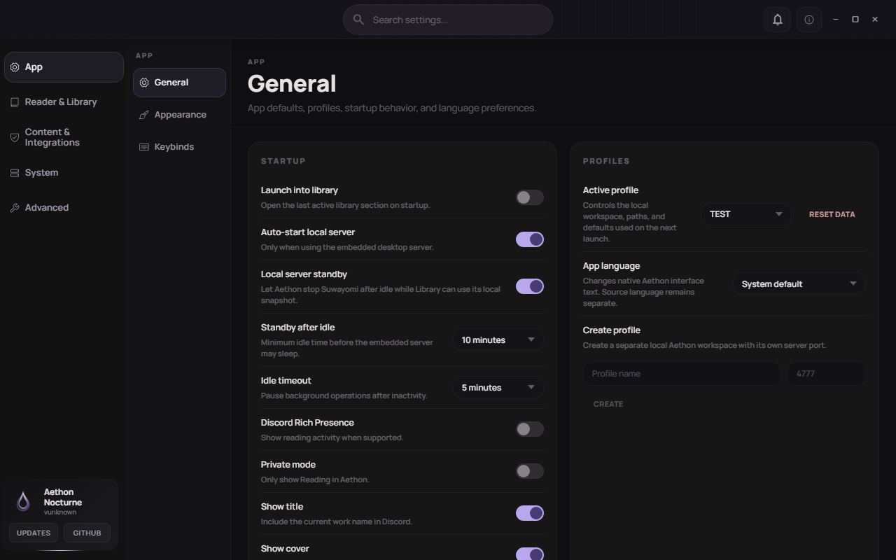
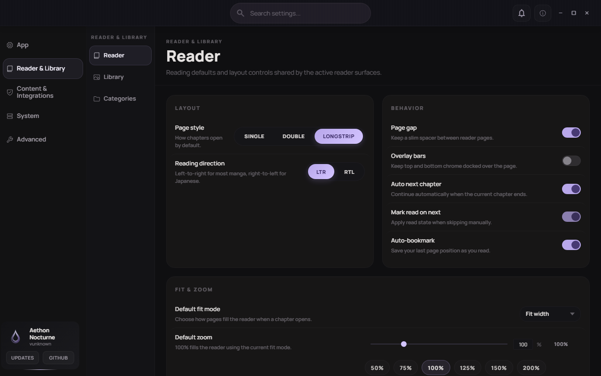
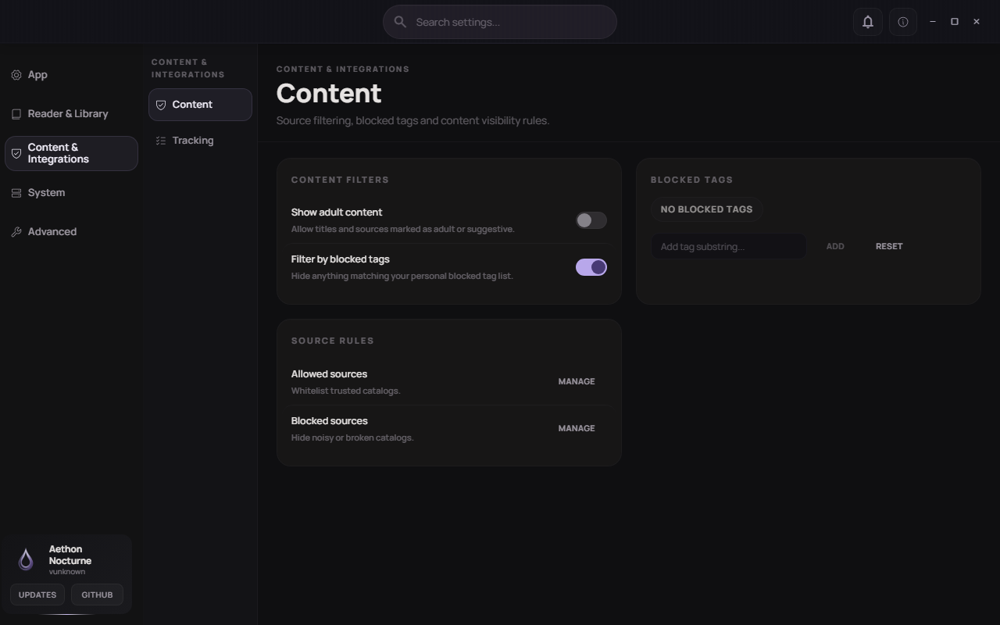
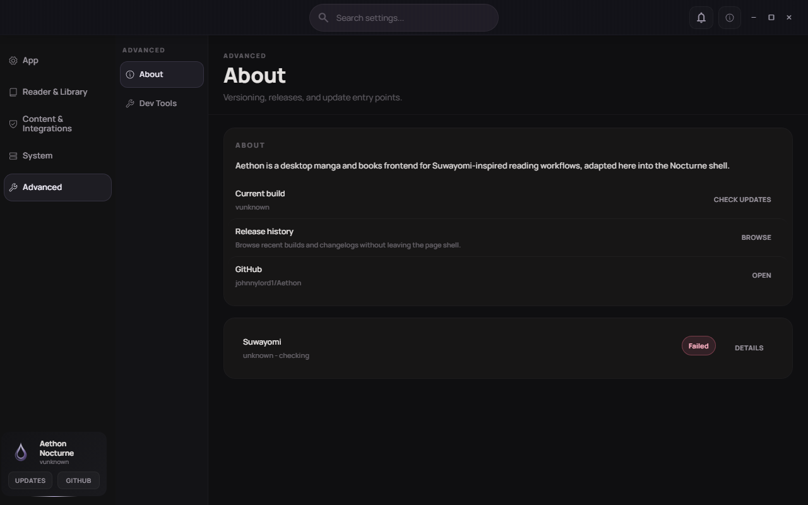

# Guia do Usuário — Epigraph Desktop

## Visão geral

Epigraph Desktop organiza comics, novels e livros locais em uma interface para Windows. As áreas principais são Home, Library, Browse, Downloads e Settings. O aplicativo pode usar um servidor Suwayomi local, sources e integrações externas; não é necessário cadastro no Epigraph para abrir um perfil local.

Este guia descreve os principais fluxos do Epigraph Desktop e as configurações necessárias para recursos locais e integrações externas.

## Requisitos

- Windows com WebView2 disponível.
- Um perfil local do Epigraph.
- Suwayomi e sources configurados para pesquisar, atualizar ou abrir conteúdo remoto.
- Credenciais próprias para trackers, Hardcover ou outras integrações que as solicitarem.
- Acesso à rede para releases, updater e catálogos externos.

Não coloque tokens, senhas ou chaves em screenshots ou relatórios de suporte.

## Primeiros passos

1. Abra o Epigraph Desktop pelo atalho ou instalador disponibilizado para Windows.
2. Aguarde a inicialização do perfil local.
3. Se o servidor local não puder iniciar, use **Try again** depois de verificar o serviço. A tela também pode oferecer entrada no shell sem o servidor; Browse e atualização de conteúdo continuarão limitados.
4. Use a barra lateral para alternar entre **Home**, **Library**, **Browse**, **Downloads** e **Settings**.

Quando o servidor local estiver indisponível, o shell continua acessível para consultar dados já armazenados; Browse e atualizações voltam a funcionar após a recuperação do serviço.

## Home e Activity Center

### Onde encontrar

Clique em **Home** na barra lateral. O sino no topo abre **Recent activity**.

### Como utilizar

1. Abra **Home** para ver itens de continuidade, atualizações recentes, estatísticas e atalhos.
2. Use **View library** para ir à biblioteca.
3. Abra o sino para consultar histórico, notificações de atualização e eventos do sistema.
4. Use a ação de retorno do painel para voltar à tela anterior.

### Resultado esperado

O dashboard mostra estados vazios quando não há dados e mantém a navegação consistente. Activity Center agrega itens recentes e marca a atividade visualizada.

### Limitações conhecidas

Capas, atualizações e estatísticas dependem do conteúdo existente no perfil e, para itens remotos, do servidor/source.

## Library

### Onde encontrar

Clique em **Library**. A tela separa comics de books/novels locais.

### Como utilizar

1. Selecione a seção **Comics** ou **Books**.
2. Digite no campo de pesquisa para reduzir os itens visíveis.
3. Abra filtros/ordenação para escolher categorias, gêneros, estado e ordem.
4. Ative o modo de seleção para aplicar ações em massa aos itens escolhidos.
5. Abra um card para acessar os detalhes quando o item estiver disponível.

### Resultado esperado

Pesquisa, filtros, ordenação, categorias e seleção atualizam a lista sem abandonar a seção ativa.

### Limitações conhecidas

- Atualização por source exige servidor e source disponíveis.
- Importação EPUB/PDF exige acesso ao arquivo local e permissão de leitura.

## Downloads

### Onde encontrar

Clique em **Downloads** na barra lateral ou no atalho do topo.

### Como utilizar

1. Consulte a fila e use a pesquisa para localizar um item.
2. Em um download existente, use as ações disponíveis para pausar, retomar, cancelar ou repetir.
3. Verifique a mensagem de estado para distinguir queued, downloading, paused, completed e failed.

### Resultado esperado

A fila preserva o item e atualiza o estado conforme a ação. Busca e estados vazios foram cobertos por testes.

### Limitações conhecidas

Downloads remotos dependem da disponibilidade da source e do servidor.

## Configurações gerais

### Onde encontrar

Abra **Settings > App > General**.

### Como utilizar

1. Revise o perfil ativo e as opções de inicialização.
2. Escolha o idioma em **App language**.
3. Ajuste auto-start/standby do servidor somente se usar o servidor local incorporado.
4. Em Discord Rich Presence, mantenha **Private mode** quando não quiser publicar título/capa.

### Resultado esperado

Os controles refletem a preferência selecionada e o perfil ativo.

### Limitações conhecidas

Discord Rich Presence requer o aplicativo Discord em execução e uma configuração compatível.

## Preferências do leitor

### Onde encontrar

Abra **Settings > Reader & Library > Reader**.

### Como utilizar

1. Selecione **Single**, **Double** ou **Longstrip** em **Page style**.
2. Escolha **LTR** ou **RTL** conforme a direção da obra.
3. Defina page gap, overlay bars, auto next chapter, mark read e auto-bookmark.
4. Ajuste fit mode e zoom padrão.

### Resultado esperado

As opções alimentam os padrões compartilhados pelos readers. HUD, zoom, navegação, progresso, bookmarks e TTS usam essas preferências.

### Limitações conhecidas

Fullscreen, TTS e atalhos dependem das permissões e capacidades disponíveis no Windows/WebView2.

## Regras de conteúdo

### Onde encontrar

Abra **Settings > Content & Integrations > Content**.

### Como utilizar

1. Defina se conteúdo adulto pode aparecer.
2. Ative o filtro por tags bloqueadas.
3. Adicione uma substring em **Blocked tags** e confirme com **Add**.
4. Use **Allowed sources** e **Blocked sources** para revisar as regras de catálogo.

### Resultado esperado

As regras atualizam o estado de Content e são aplicadas como filtro às superfícies compatíveis.

### Limitações conhecidas

Filtros dependentes de catálogo são aplicados somente às sources configuradas e compatíveis.

## Sources e repositórios de extensões

### Onde encontrar

Abra **Browse > Sources** e use **Manage repos**.

### Como utilizar

1. Cole o endereço da página principal do repositório no GitHub ou o link
   direto de `index.pb`, `index.json` ou `index.min.json`.
2. Clique em **Add**. O Epigraph converte páginas válidas do GitHub para o
   índice consumido pelo Suwayomi e atualiza o catálogo.
3. Instale ou atualize as extensões exibidas e aguarde as sources aparecerem.

O salvamento é aditivo: um repositório atual só é removido depois que os novos
endereços foram aceitos. Links para páginas internas do GitHub que não
representam um repositório ou índice mostram uma orientação sem alterar a
configuração existente.

## Backup e restauração

### Onde encontrar

Abra **Settings > System > Storage**, escolha **Create backup** ou
**Restore backup**.

### Como criar

1. Escolha o backup unificado ou apenas Comics, Books, Novels ou dados do app.
2. No backup unificado, marque os tipos de conteúdo desejados.
3. Clique em **Export backup** e escolha o destino.

O backup unificado de Comics registra os repositórios de extensões configurados.
Books preserva arquivos quando o modo completo está ativo; o modo metadata-only
preserva somente metadados e estado de leitura.

### Como restaurar

1. Clique em **Choose file** e selecione `.epigraphbk`, um backup nativo de
   manga ou um ZIP compatível com LNReader.
2. Revise os cards com tipos de conteúdo, quantidade de títulos e avisos.
3. Escolha o perfil de destino e confirme explicitamente a restauração no
   perfil atual.
4. Inicie o restore e acompanhe o indicador de progresso.

Quando o backup declara dependências, o Epigraph primeiro mostra os
repositórios e extensões encontrados. Somente depois da aprovação explícita ele
adiciona os repositórios ausentes, atualiza os catálogos e instala os
plugins/extensões disponíveis antes de incluir as obras na Library.
Repositórios existentes não são duplicados nem apagados. Se uma dependência não
existir mais, a obra e o ID de source original são preservados para uma
reconexão futura; a exclusão só ocorre quando o usuário escolhe **Skip**.

Um ZIP nativo do LNReader não grava um campo isolado chamado “repository”. Ele
inclui a lista de plugins instalados, o URL de cada script e os pacotes em
`download.zip`. O Epigraph usa esses metadados para derivar o manifesto
`plugins.min.json` da mesma origem, adiciona somente as origens necessárias e
instala cada plugin a partir do repositório correspondente.

Backups modernos do Mihon podem incluir `backupExtensionStores` (campo 106)
quando essa opção foi marcada na origem; o Epigraph preserva nome, URL,
assinatura e metadados desconhecidos e ainda exige aprovação antes de gravar um
store. Backups J2K/Yokai podem não trazer esse campo — os arquivos reais usados
na certificação não trazem — e nenhum formato inclui APKs. Nesse caso, adicione
um catálogo atual em **Browse > Sources > Manage repos**. O Epigraph mantém as
sources indisponíveis com o ID original em vez de remapear ou apagar obras.

O J2K também pode incluir entradas lidas que não estão mais na Library. O
Epigraph respeita o campo `favorite` do formato: somente favoritos entram na
Library, enquanto registros não favoritos continuam disponíveis para restaurar
histórico e progresso. No protobuf do J2K, `favorite` ausente significa `true`;
esse valor padrão não deve ser confundido com uma entrada fora da Library.
Nos fixtures certificados, J2K contém 686 obras na Library e 2.198 entradas de
histórico; Yokai contém 684 obras na Library e 2.109 entradas de histórico.

## About e atualizações

### Onde encontrar

Abra **Settings > Advanced > About**.

### Como utilizar

1. Confira **Current build**.
2. Use **Browse** em release history para consultar versões quando houver rede.
3. Use **Check updates** somente em uma build assinada/configurada.
4. Abra **Details** do runtime Suwayomi para diagnosticar um status failed/checking.

### Resultado esperado

About apresenta build, releases, GitHub e status do Suwayomi. Histórico e atualização são carregados quando os serviços de release estão acessíveis.

### Problemas conhecidos

O updater e o histórico dependem de rede, endpoint de releases e assinatura válida do pacote.

## Syncd e Epigraph Mobile

O Epigraph Core fica hospedado no PC e continua funcionando com a janela do
desktop fechada. Ele mantém o Suwayomi que é a autoridade dos comics e expõe
uma conexão autenticada para o Epigraph Mobile. Syncd replica estado de novels,
books e os complementos de comics (histórico e bookmarks de página).

O PC precisa estar ligado, com o usuário do Windows conectado e com o Core e o
Suwayomi em execução para pesquisar comics, abrir capítulos remotos ou aplicar
mutações online. O celular continua lendo arquivos e capítulos explicitamente
baixados quando o PC estiver desligado.

### Criar uma conexão desktop ou mobile

1. No desktop que hospedará a sessão, abra **Settings > Security > Syncd**.
2. Selecione **Pairing** e clique em **Create pairing QR**.
3. O Epigraph prepara automaticamente a conexão e exibe o QR.
4. No segundo desktop ou no Epigraph Mobile, escolha o host descoberto ou importe o QR.
5. Confirme a solicitação no desktop host.
6. Aguarde os dois painéis exibirem a sessão como **Connected** e a replicação como **Live**.

Se a descoberta automática não localizar o host, informe manualmente o endereço mostrado no painel do desktop host.

### Gerenciar sessões e replicação

1. Abra **Details** para consultar os desktops pareados e o estado de cada sessão.
2. Use **Set active** para escolher a sessão responsável pela replicação atual.
3. Use **Pause replication** quando quiser manter a sessão sem enviar ou receber mudanças.
4. Use **Resume** para continuar ou **Reconnect now** para restabelecer uma conexão interrompida.
5. Use **Forget** somente quando quiser remover permanentemente uma sessão daquele desktop.

### Ordem planejada da primeira sincronização móvel

O fluxo abaixo descreve a ordem planejada para depois da conclusão da bridge
Suwayomi -> Core. No estado atual, o Core não publica catálogo, categorias ou
capítulos de comics para o mobile; a sincronização disponível permanece focada
em histórico e bookmarks de página.

Quando a bridge estiver disponível, o bootstrap deverá seguir esta ordem:

1. negocia protocolo, capabilities, perfil e fingerprint TLS;
2. confirma os repositórios/extensões e plugins necessários, sem instalar APK
   silenciosamente;
3. inventaria categorias, obras, bindings, capítulos e downloads;
4. cria/atualiza categorias antes das associações;
5. consulta a biblioteca e o estado de capítulos pelo Suwayomi através do Core;
6. aplica progresso, bookmarks, histórico e tracking;
7. transfere somente EPUB/PDF e outros assets explicitamente compartilhados;
8. reconcilia conjuntos completos e só exibe **Synced** quando a outbox estiver
   vazia.

Mangás, capítulos de comics e novels não são baixados automaticamente durante
o pairing. Falha temporária, resposta parcial ou Suwayomi em manutenção nunca
remove uma obra da réplica local.

### Múltiplas instâncias

O Epigraph gerencia automaticamente os recursos necessários para cada instância. Não é preciso escolher portas, editar arquivos internos ou encerrar processos manualmente. Se outra instância estiver aberta no mesmo computador, cada uma permanece isolada e pode ser fechada sem interromper as demais.

## Funcionalidades que exigem configuração

- Browse/Discover/Search reais: dependem de Suwayomi, sources ou plugins.
- Tracking e Hardcover: dependem de credenciais/configuração ausente.
- Discord Rich Presence: depende do Discord e configuração local.
- FlareSolverr: é opcional e desativado por padrão. Pode ser habilitado em
  **Settings > Security** quando uma source apresentar proteção anti-bot
  confirmada. O Epigraph pode gerenciar uma instância local ou Docker; ele não
  corrige source obsoleta, login obrigatório, parser quebrado ou extensão
  incompatível.
- Updater: depende de release, rede e assinatura.
- Importação EPUB/PDF, backup e restore: exigem permissões de arquivo e um destino de armazenamento acessível.
- Migração individual/em massa: depende de sources de origem e destino.

## Solução de problemas

### O perfil não inicia

1. Verifique se o servidor local esperado está ativo.
2. Use **Try again** uma vez após a verificação.
3. Entre no shell sem servidor apenas para consultar dados locais; Browse e atualizações podem ficar indisponíveis.
4. Consulte **Settings > Advanced > About > Suwayomi > Details** quando a tela estiver acessível.

### Uma source não retorna resultados

Confirme que o repositório/extensão está instalado e habilitado, que o idioma/filtro de conteúdo permite a source e que o servidor está acessível. Não reutilize credenciais em campos que não as solicitam.

### Storage permanece em “Refreshing…”

Aguarde a leitura dos caminhos e do uso de disco. Se o estado persistir, reabra Settings e consulte os logs em **Settings > Advanced > Dev Tools**, sem compartilhar caminhos privados ou credenciais.

## Perguntas frequentes

### Preciso de conta Epigraph?

Não para um perfil local. Integrações externas podem exigir conta/token próprios.

### Posso ler sem internet?

Sim. Conteúdo local ou previamente baixado permanece disponível; catálogos, atualização e novos downloads exigem rede.

### Posso conectar o Syncd a um celular?

Este guia cobre Syncd entre instâncias do Epigraph Desktop. Use outro Epigraph Desktop como host ou participante da sessão.

## Glossário

- **Source:** provedor de catálogo/conteúdo.
- **Suwayomi:** serviço local usado por fluxos de manga do desktop.
- **Syncd:** sincronização entre instâncias Epigraph Desktop.
- **Profile:** workspace local com preferências e dados próprios.
- **Tombstone:** registro de exclusão usado para convergir sincronização.
- **Replay:** reaplicação de eventos Syncd após reconexão.
